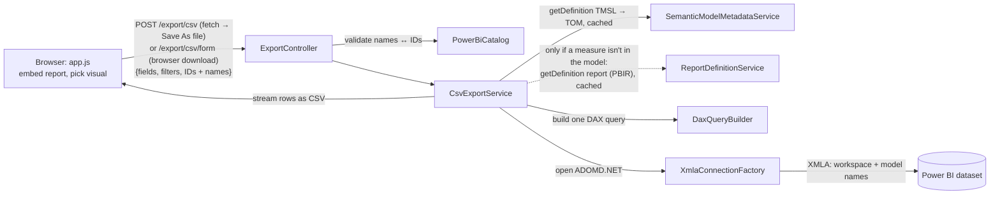

# Copilot / AI-agent instructions — PbiVisualExport

> Curated context for AI coding agents (GitHub Copilot, and any agent that reads
> `.github/copilot-instructions.md` or `AGENTS.md`). Read this first, then open the
> file named for the task in the **Task → file map** below. Keep changes surgical
> and match existing patterns.

## What this sample is

A web service that exports a **selected Power BI visual to CSV**, bypassing the
row limits of the report's built-in "Export data". The browser embeds a report,
the user picks a visual, and the app reconstructs that visual's query
server-side and streams an arbitrarily large CSV.

The trick: the front end gathers the visual's fields + active filters/slicers via
the **Power BI Client JS API** and posts them with the workspace/dataset/report
**IDs and names**. The .NET back end loads the semantic model's metadata into a
**TOM** model (data types, format strings, sort-by columns, M parameters), builds
**one DAX query** (`SUMMARIZECOLUMNS` + optional `FORMAT()`), runs it over the
workspace **XMLA endpoint** with **ADOMD.NET**, and streams the rows to CSV as they
arrive. XMLA has none of the REST `executeQueries` row/value/byte caps, so there
is **no paging** — a 2M-row × 30-column export is a single query (~95 s formatted,
~82 s raw, vs ~1,220 s with the old executeQueries paging).

## Tech stack

- **.NET 10** ASP.NET Core (MVC view + Web API controllers) — `src/PbiVisualExport.Web`.
- Front end is plain JS (`wwwroot/js/app.js`) + one Razor view (`Views/Home/Index.cshtml`) using `powerbi-client`.
- NuGet: `Azure.Identity` (auth), `Microsoft.PowerBI.Api` (embed token, list reports/datasets),
  `Microsoft.AnalysisServices.NetCore.retail.amd64` (**TOM**, read model metadata),
  `Microsoft.AnalysisServices.AdomdClient.NetCore.retail.amd64` (**ADOMD.NET**, the XMLA data path).
- Infra/authoring: PowerShell + Fabric REST (`infra/`), plus two small console tools (`tools/`).

## Build, run, debug

```pwsh
# Prereq for the default dev auth mode (AzureCli): sign in first.
az login

# Run the web app. launchSettings.json sets Development (loads user secrets) + port 5099.
dotnet run --project src/PbiVisualExport.Web
# open http://localhost:5099
```

- Requires the **.NET 10 SDK**, and on first use the local settings from
  *Configuration* below (at minimum `PowerBI:WorkspaceId` in user secrets). Without
  it the app exits at startup with a message naming the fix.
- In dev mode the **first export** asks for a one-time XMLA device-code sign-in
  (the UI shows the code; it is also logged as `XMLA DEVICE CODE`). See
  *XMLA credential* below.
- **`InvariantGlobalization` is false on purpose** — DAX `FORMAT()` and CSV output
  depend on culture-aware formatting. Don't flip it to true.
- There is **no `.sln` for the app** (the only `.sln` lives under `_sample/`, which is
  the untouched upstream Microsoft sample — reference only, not the running app).

## Configuration (settings cascade)

Environment-specific IDs are **not committed**. `appsettings.json` holds the keys
(with empty IDs) and non-environment defaults. The standard ASP.NET Core
providers are layered; **later wins**:

| Layer | Loaded | Used for |
|---|---|---|
| `appsettings.json` | always | committed defaults, empty IDs |
| `appsettings.{Environment}.json` | if present (`appsettings.Development.json` is git-ignored) | optional local tweaks |
| **User secrets** (`<UserSecretsId>` in the csproj) | **Development only** | the local secret store: this dev box's IDs |
| **Environment variables** (`Section__Key`) | always | deployed: App Service settings, containers; Key Vault references also arrive this way |
| Command line (`--Section:Key value`) | always | one-off overrides |

`dotnet run` picks up `Properties/launchSettings.json`, which sets Development and
port 5099. Running the built exe directly defaults to **Production**, so no user
secrets load; pass `--environment Development` for local runs
(`infra/perf-export.ps1` does this).

Local setup (values live in
`%APPDATA%\Microsoft\UserSecrets\7ad05434-b6db-4caf-8ad0-a97c908c87ae\secrets.json`,
outside the repo):

```pwsh
dotnet user-secrets set PowerBI:WorkspaceId <workspace-guid> --project src/PbiVisualExport.Web
dotnet user-secrets set AzureAd:TenantId   <tenant-guid>    --project src/PbiVisualExport.Web
dotnet user-secrets set PowerBI:ReportId   <report-guid>    --project src/PbiVisualExport.Web  # optional
dotnet user-secrets list --project src/PbiVisualExport.Web
```

Deployed with a service principal (app settings or environment variables):

```
AzureAd__AuthenticationMode = ServicePrincipal
AzureAd__TenantId           = <tenant-guid>
AzureAd__ClientId           = <app-registration client id>
AzureAd__ClientSecret       = <secret>   # prefer @Microsoft.KeyVault(SecretUri=...) on App Service
PowerBI__WorkspaceId        = <workspace-guid>
PowerBI__ReportId           = <report-guid>   # optional
```

(`MasterUser` uses `AzureAd__PbiUsername` / `AzureAd__PbiPassword` in place of the
secret.)

- `PowerBI:WorkspaceId` is **required** and validated at startup
  (`ValidateOnStart` in `Program.cs`). A missing or invalid value stops the app with
  a message giving both the user-secrets command and the env-var name.
- `PowerBI:ReportId` is optional. When empty, the UI selects the first report in
  the workspace.
- `AzureAd:TenantId` is optional for `AzureCli`/`DeviceCode` and required for
  `ServicePrincipal`/`MasterUser` (`PbiTokenProvider.Require`).
- `AzureAd:XmlaClientId` (`cf710c6e-…`) and the Azure CLI client ID used by the
  tools are **Microsoft's well-known public clients**, the same in every tenant.
  They stay committed.
- When adding a new environment-specific setting: add the key to
  `appsettings.json` with an empty value and a `"// Key"` note, bind it in
  `Options/Options.cs`, and document it here. Never commit the real value.
- `tools/XmlaSmoke` uses the **same `UserSecretsId`** (it shares
  `AzureAd:TenantId`) and adds `XmlaSmoke:DatasetId`, which is required. Its
  cascade is built by hand in `Program.cs`, and it always loads user secrets
  because it's a dev-only tool.

## Authentication model (important)

All tokens come from **one `TokenCredential`** built by
`Auth/PbiTokenProvider.cs`, selected by `AzureAd:AuthenticationMode`:

| Mode | Credential | Use |
|---|---|---|
| `AzureCli` (default) | `AzureCliCredential` | Dev "super user" — whoever ran `az login`. |
| `ServicePrincipal` | `ClientSecretCredential` | Deployment. Needs `ClientId`/`ClientSecret`. |
| `MasterUser` | `UsernamePasswordCredential` | Legacy master-user embedding. |
| `DeviceCode` | `DeviceCodeCredential` | Headless / no browser. Watch the log for the code. |

**Two token audiences, do not mix them up:**
- **Power BI** (`https://analysis.windows.net/powerbi/api/.default`) — embedding,
  `GenerateToken`, the report/dataset catalog, and the **XMLA** data path.
- **Fabric** (`https://api.fabric.microsoft.com/.default`) — `getDefinition`
  (the metadata path: `FabricDefinitionClient`, for semantic models and reports).

A Power BI-audience token will fail Fabric item calls with `InsufficientScopes`,
and vice-versa. `PbiTokenProvider.GetPowerBiTokenAsync` / `GetFabricTokenAsync`
already pick the right one — reuse them.

### XMLA credential (`Auth/XmlaTokenProvider.cs`)

The XMLA endpoint **rejects Azure CLI tokens** ("Authentication failed for all
authenticators") even though the REST APIs accept them. So the data path has its
own credential, chosen by `AzureAd:XmlaAuthenticationMode`:

| Mode | Behaviour |
|---|---|
| `Auto` (default) | `DeviceCode` when the main mode is `AzureCli` (or `DeviceCode` without a `ClientId`); otherwise `Shared`. |
| `Shared` | Reuse the main credential — the **deployment** path (`ServicePrincipal` / `MasterUser`). |
| `DeviceCode` | Device-code sign-in with `AzureAd:XmlaClientId` (default `cf710c6e-dfcc-4fa8-a093-d47294e44c66`, the Analysis Services public client ADOMD.NET itself uses). |

Dev device-code flow is **non-blocking**: the first export returns **HTTP 401**
`{ signInRequired, verificationUri, userCode }`; the UI shows the code and polls
`GET /export/xmla-auth` until `signedIn`, then the user re-runs the export. The
refresh token is kept in a DPAPI-protected MSAL cache (`PbiVisualExport.Xmla`)
plus an `AuthenticationRecord` at
`%LOCALAPPDATA%\PbiVisualExport\xmla-auth-record-{clientId}.json`, so later
requests and restarts are silent. ADOMD's `OnAccessTokenExpired` re-mints tokens
for exports that outlive one.

> For `ServicePrincipal` mode the SP must (a) be enabled by the tenant setting
> "Service principals can use Fabric/Power BI APIs" and (b) be added to the
> workspace. Otherwise expect `Unauthorized` (tenant setting) or `RequestFailed`
> (not in workspace).

## Architecture — export flow



## Repository layout

```
src/PbiVisualExport.Web/
  Program.cs                     DI wiring + routes (MVC + attribute-routed API)
  appsettings.json               Keys + defaults only (IDs empty; see Configuration): AzureAd / PowerBI / Export / MetadataCache
  Properties/launchSettings.json `dotnet run` profile: Development (loads user secrets), http://localhost:5099
  Auth/PbiTokenProvider.cs       Credential factory + PBI/Fabric token minting
  Auth/XmlaTokenProvider.cs      XMLA credential (Shared, or non-blocking dev device-code sign-in)
  Options/Options.cs             AzureAdOptions, PowerBIOptions, ExportOptions, MetadataCacheOptions
  Controllers/
    HomeController.cs            GET /            (the embed page)
    EmbedInfoController.cs       GET /embedinfo/reports, GET /embedinfo/getembedinfo?reportId=
    ExportController.cs          POST /export/csv (JSON body; validates + streams), POST /export/csv/form (same, form post +
                                 antiforgery, for browser downloads), POST /export/prepare (validate + plan, no data),
                                 GET /export/xmla-auth, POST /export/bench (perf, off by default)
  Services/
    PbiEmbedService.cs           List reports + GenerateTokenV2 (embed token)
    PowerBiCatalog.cs            Cached workspace/dataset/report ID → name lookups (validation)
    FabricDefinitionClient.cs    Shared Fabric getDefinition POST + 202/LRO poll → decoded definition parts
    SemanticModelMetadataService.cs  Semantic model getDefinition(TMSL) → TOM (delegates storage to MetadataCache)
    ReportDefinitionService.cs   Report getDefinition → ReportDefinition (format, parts, reportExtensions.json measures), cached
    MetadataCache.cs             In-memory + single-flight + on-disk cache of definitions, keyed by (kind, item id)
    ExportRequestException.cs    Request can't be exported as sent (e.g. unknown field) → HTTP 400
    DaxQueryBuilder.cs           VisualExportRequest + TOM → single DAX query (DaxPlan)
    XmlaConnectionFactory.cs     Opens ADOMD.NET connections (names only) with the XMLA token
    CsvExportService.cs          Orchestrates: metadata → DAX → XMLA reader → CSV stream
  Models/Models.cs               VisualExportRequest, ExportField, Embed* DTOs
  Views/Home/Index.cshtml        Toolbar (report/visual pickers, Export, debug panel), hidden download form (+ antiforgery token)
  wwwroot/js/app.js              Embed, gather fields+filters, streamed download (Save As picker / form post), debug panel
infra/                           Fabric authoring (see infra section)
tools/                           WhSql (seed Warehouse), XmlaSmoke (legacy TOM + executeQueries smoke test)
_sample/                         Upstream MS "Embed for your customers/AppOwnsData" clone (reference only; git-ignored)
```

## The export pipeline, file by file

- **`app.js`** embeds the report, populates the **report** dropdown from
  `/embedinfo/reports` and the **visual** dropdown from the embedded page, then on
  *Export* gathers the visual's fields (`getCapabilities`/`getDataFields`) and all
  active filters (visual + page + report + slicers) and sends a
  `VisualExportRequest` (see **Download path** below). Slicers on a page that isn't rendered
  throw `visualConfigIsNotInitialized` from `getSlicerState`, so `gatherFilters`
  **activates the visual's page** and retries. The SDK serializer also throws on
  some slicers (a slicer with no saved selection → `reading 'general'`); then the
  slicer is looked up in the captured bookmark (`singleVisual.objects.merge.general[].properties.filter`):
  no filter there = no selection, otherwise the export **aborts** (dropping a slicer
  would silently over-export). The **debug panel** shows the exact JSON
  payload sent to the API. **Column order** is the `getDataFields(role)` order
  (it reflects in-session reorders). The **sort** is not exposed by any SDK getter:
  `gatherSort` reads it from `report.bookmarksManager.capture({allPages:true})`
  (`state` = base64 gzip JSON → `explorationState.sections[page].visualContainers[visual].singleVisual.orderBy[]`).
  That array holds the live sort **and** the saved PBIR `sortDefinition`; if it's
  absent the visual has no explicit sort. A **Sort like visual** checkbox sets
  `applySort`. A **Format values** checkbox sets `applyFormatStrings`;
  a **Native export** button runs `visual.exportData(Summarized, 2000)` for a quick
  side-by-side comparison with Power BI's own export (the service caps it at 30k
  rows, but 30k on a wide visual can run for many minutes). On a 401
  `signInRequired` it shows the XMLA device code and polls `/export/xmla-auth`.
- **Download path** (`doExport` in `app.js`). The browser never buffers the file,
  and `fetch()` ignores `Content-Disposition`, so there are two paths:
  1. **`showSaveFilePicker` (Chromium)**: called *first*, while the click still
     counts as a user gesture, so the user gets a real Save As dialog. Then
     `fetch POST /export/csv` and `resp.body.pipeTo(handle.createWritable())`,
     with KB/MB progress and in-page errors. Cancelling the dialog is
     "Export cancelled.". On failure the picked file is removed only if it is
     still empty (`discardFile`).
  2. **Fallback** (no picker, or it throws `SecurityError`, e.g. in a
     cross-origin frame):
     - `POST /export/prepare` pre-flights validation, planning and the XMLA
       token as JSON, so errors and the sign-in flow still show in the page.
     - Then the hidden `#download-form` (antiforgery token + `request` JSON +
       `downloadToken`) is submitted into a hidden iframe. The browser's
       download manager applies `Content-Disposition` and streams to disk. Save
       As only appears if the browser's "ask where to save" setting is on.
     - Download started: the server sets cookie `pbiexport-dl-{token}=1` with
       the response headers, and the page polls `document.cookie` for it.
     - Error: a download never fires the iframe `load` event, but an error
       response does. The page then reads the iframe's JSON body.
     - A successful frame is kept, because removing it could cancel the
       download in some browsers.
- **`ExportController`**: `ExportCsv` (`[FromBody]`) and `ExportCsvForm` (form
  field `request` = the same JSON, `[ValidateAntiForgeryToken]` because a form
  post is CSRF-able; a JSON post isn't, without CORS) share `StreamCsvAsync`:
  - It validates the request (below).
  - It sets `Content-Disposition` via
    `ContentDispositionHeaderValue.SetHttpFileName`: ASCII `filename=` +
    UTF-8 `filename*`. Kestrel rejects non-ASCII header values, so a raw
    title would 500.
  - For a valid `downloadToken` (`[A-Za-z0-9_-]{1,64}`) it sets the
    download-started cookie.
  - Then it delegates to `CsvExportService.ExportAsync`, which writes directly
    to `Response.Body`.
  - Errors before the first row → clean JSON 400/401/500 (`Response.Clear()`
    also drops the cookie). Errors mid-stream abort the connection (never a
    silently truncated file).
  - `Prepare` runs validation, `CsvExportService.PlanAsync` (cached metadata +
    DAX build) and the XMLA token check, and returns
    `{fileName, columns, sort, reportMeasures, measureFilters, warnings}`.
  - An `ExportRequestException` from planning (a field that's in neither the
    model nor the report's measures, a non-PBIR report, a visual with no
    exportable fields) → **400** `{error}` from `csv`, `csv/form`, `prepare` and
    `bench`.
  - `Program.cs` sets `AddAntiforgery(SuppressXFrameOptionsHeader = true)` so
    the page can still be framed by a host app.
- **Request validation**: all six identifiers are required. IDs must be GUIDs, the
  workspace must be the configured `PowerBI:WorkspaceId`, each **name must match
  its ID** (case-insensitive, via `PowerBiCatalog`, 10-min cache, one forced refresh
  on a miss), and the report must be bound to the dataset. This matters because
  metadata is fetched **by ID** (Fabric) but data **by name** (XMLA) — a mismatch
  would silently mix two models.
- **`CsvExportService`** plans the query (`PlanAsync`, see **Report-level
  measures** below), opens an ADOMD.NET connection via `XmlaConnectionFactory`, runs the **single**
  query with `ExecuteReader`, writes a UTF-8 (BOM) header row, and streams each row,
  flushing every 16k rows — memory stays flat at any size (see **Performance**
  below). `Export:MaxRows` > 0 wraps the query in `TOPN`;
  `Export:CommandTimeoutSeconds` 0 = no timeout. Raw values are written
  culture-invariant with full precision (`double` round-trip `R`, exact
  `decimal`/`long`, ISO-8601 datetimes, `true`/`false`, BLANK → empty).
- **`DaxQueryBuilder.Build`** returns a `DaxPlan`; `BuildQuery(maxRows)` emits
  `DEFINE [MEASURE …] VAR _summ = SUMMARIZECOLUMNS(...) EVALUATE SELECTCOLUMNS(_summ, "c0", ..., "c1", ...)`:
  - Dimension columns → `SUMMARIZECOLUMNS` group-by; measures / implicit
    aggregations → extension columns `m_0, m_1, …`. Output columns get positional
    aliases `[c0]…` in **visual order** — dims and measures interleaved exactly as
    the visual shows them (CSV headers come from `DaxOutputColumn.Header`).
  - **Row order** (`applySort`, default on) → `ORDER BY` after `SELECTCOLUMNS`
    (or `TOPN(n, …, key, 0|1)` when `MaxRows` caps). Sort keys are always **raw**
    values: if the output column is `FORMAT`-ted, a hidden `[sN]` column carries
    the raw value (it isn't written to the CSV). A sort on a measure/aggregation
    not in the visual is added as a sort-only extension column; a column's model
    `SortByColumn` is honored (added to the group-by). With **no explicit sort**,
    Power BI's implicit order isn't reproducible exactly; we approximate with the
    visual's dimension columns ascending in visual order ("implicit default").
    `ORDER BY` makes the engine materialize and sort the whole result before the
    first row: on 2M × 31 `detail1` (formatted, Release), first byte 41.6 s / total
    215 s sorted vs 1.3 s / 95 s unsorted — hence the toggle. (Sorted formatted
    exports also stream the hidden raw `[sN]` keys, roughly doubling the wire width.)
  - Model **format strings** applied with DAX `FORMAT(...)` only when the column/
    measure **has** one and `applyFormatStrings` is true (strings pass through).
  - **Hidden fields** — two unrelated kinds:
    - **Model-hidden** (TOM `IsHidden`) columns/measures placed on a visual are
      displayed by the visual and included by native export, so they're exported
      like any other field. A grouping column must never be dropped: it would
      merge rows and re-aggregate every measure (summary1 + `Internal Hash`,
      filtered to 100 rows: 100 rows with it vs 20 without).
    - **Hidden on the visual** ("Hide fields on the visual" / `visual.setFieldHidden`,
      reported by `getDataFields` as `hidden: true` → `ExportField.Hidden`): only
      measures/aggregations can be hidden (hiding a column fails with
      `FailedToSetFieldHidden`). They stay in `SUMMARIZECOLUMNS` — a measure
      affects which rows are non-blank — but aren't projected, matching native
      summarized export, which omits them.
  - **Filters** — the query mirrors the DAX Power BI itself generates (captured
    with a trace), all as `SUMMARIZECOLUMNS` filter arguments:
    - **Column targets** → `VAR _f{i}`: basic In/NotIn (`TREATAS` /
      `FILTER(ALL(...))`) and advanced comparison conditions.
    - **Top N** (`#topN`, `filterType 5`) → `VAR _tn{i} = TOPN(n, SUMMARIZECOLUMNS(col,
      _f*, "tn", orderBy), [tn], 0|1)` (0 = Top, 1 = Bottom; ties kept). Each Top N is
      ranked under the column filters only, independently of other Top N/value filters.
    - **Value filters** on a **measure** (`{table, measure}`) or **implicit measure**
      (`{table, column, aggregationFunction}`) → one `VAR _vf = FILTER(KEEPFILTERS(
      SUMMARIZECOLUMNS(dims, _f*, _tn*, "m_i", …, "vf_j", IGNORE(expr))), pred && …)`,
      evaluated at the **visual's grain**. A measure the visual shows reuses its `[m_i]`;
      a filter-only one is an `IGNORE`d `[vf_j]` (IGNORE keeps it from affecting
      blank-row elimination). All value filters are ANDed; a card's own conditions use
      its `logicalOperator`. `_vf` then filters `_summ` like any table, so the result
      is Power BI's two-pass evaluation (e.g. an `ALLSELECTED` % of total sees the
      value filter), not a post-filter of `_summ`.
    - Filter cards with no conditions (`conditions: []`, `itemCount: 0`) are ignored.
      A filter measure must exist in the model or the report's measures (report
      measures are defined via `DEFINE MEASURE` like visual ones), else **400**.
      `/export/prepare` returns the applied value/Top N filters as `measureFilters`.
    - Cost: `_vf` must be materialized before the first row. On 2M × 31 `detail1`
      with a filter-only `[Total Sales] > 100`: first byte 9.8 s vs 1.2 s, total
      96.2 s vs 92.4 s (still = read time); memory unchanged.
    - Before this, an implicit-measure target was mistranslated as a filter on the
      raw column's values; it now filters the aggregate.
    - **Hierarchy** targets (hierarchy slicers `filterType 9`, tuple filters
      `filterType 6`) are skipped with a warning (a known gap).
- **`XmlaConnectionFactory`** — XMLA addresses by **name only**:
  `Data Source = {PowerBI:XmlaEndpoint}/{workspace name}`, `Initial Catalog =
  {semantic model name}` (GUIDs are rejected). Workspace needs Premium/Fabric
  capacity with XMLA read enabled.
- **`FabricDefinitionClient`** POSTs Fabric `.../{itemPath}/getDefinition[?format=]`
  (Fabric-audience token), handles the 202 + LRO poll (`Location` → `…/result`) and
  returns the base64-decoded parts. Shared by the two definition services.
- **`SemanticModelMetadataService`** downloads `semanticModels/{id}` as TMSL and
  takes the `model.bim` part. It owns only the **download** and parse; storage is
  delegated to **`MetadataCache`** (kind `tmsl`). Parsing **must** pass
  `CompatibilityMode.PowerBI` to `JsonSerializer.DeserializeDatabase` — the default
  (AnalysisServices) mode rejects Power BI-only properties (e.g. a field parameter's
  `relatedColumnDetails`) with "Unrecognized JSON property". `GetModelAsync(workspaceId, datasetId,
  maxAge, ct)` — `maxAge` null = the TTL, `TimeSpan.Zero` = bypass all cache layers.
- **`ReportDefinitionService`** downloads `reports/{id}` **without** `format`
  (`?format=PBIR` fails on legacy reports; we want to detect them, not fail the
  download), and caches (kind `report`) a JSON snapshot of the text parts
  (`StaticResources/` skipped): format + `path → text`. Parsed as
  `ReportDefinition`: `Format` (`PBIR` when a `definition/report.json` part exists,
  `PBIR-Legacy` for a root `report.json`, else `Unknown`), `Parts` (kept for future
  report-design features) and, for PBIR only, the `reportExtensions.json` measures.
- **`MetadataCache`** avoids re-downloading definitions on every export. Keyed by
  **(kind, item id)**; three layers, all governed by `MetadataCacheOptions`
  (`MetadataCache` config section): (1) in-process parsed value (`TOM.Model` /
  `ReportDefinition`); (2) **single-flight** — a per-key `SemaphoreSlim` so
  concurrent misses download once; (3) **on disk** — the raw text is persisted
  (`%TEMP%\pbivisualexport-metadata-cache\{id:N}.{kind}.json`, i.e. `….tmsl.json`
  / `….report.json`) so a **restart** reuses it. Ages count from the **download**
  (a disk hit keeps the file's write time), so a restart doesn't extend the TTL.
  `TtlMinutes <= 0` = never expire. Cached values are **shared** and must be
  treated as read-only. Options: `Enabled`, `TtlMinutes` (60), `PersistToDisk`
  (true), `DiskCacheDirectory` (blank = temp), `RefreshOnMissSeconds` (60).
  - **Invalidation** is deliberately simple — models and reports change at planned
    deployments: entries expire after the TTL, and a field that can't be resolved
    triggers one re-download of any definition older than `RefreshOnMissSeconds`
    (so a just-deployed column/measure is picked up; repeated bad requests don't
    hammer Fabric). **The disk cache survives an app recycle** — after a deployment
    delete the cache folder (or run with `PersistToDisk=false`) to force a reload.
- **Report-level measures** (`CsvExportService.PlanAsync`). A report can define its
  own measures in `definition/reportExtensions.json` (enhanced PBIR); the JS client
  sends them like model measures (`{table, measure}` fields / sort entries). Flow:
  1. `DaxQueryBuilder.FindUnresolvedFields(request, model)` lists fields, sort
     measures and **measures named by active value/Top N filters** that the (cached)
     model lacks. None → build from the model alone; **the
     report definition is never downloaded** for such visuals.
  2. If any unresolved field is a **measure**, load the (cached) report definition
     and match it against the report's measures (case-insensitive; names are unique
     across model + report). Unknown columns never need the report.
  3. Still unresolved → refresh-on-miss (above), then re-check.
  4. Still unresolved → `ExportRequestException` (400): columns "not found in
     semantic model"; measures "not found in the model or the report's measures" —
     or, when the report isn't PBIR, "can only be read from a PBIR (enhanced
     format) report … save it in PBIR format and republish". A sort-only key that
     can't be resolved just adds a warning (as before).
  5. `Build(request, model, report)` emits each used report measure — plus the
     report measures it references (`references.measures` with `schema:
     "extension"`, or a `[Name]` token matching a report measure), dependencies
     first, cycle-safe — as a query-scoped `DEFINE MEASURE 'Entity'[Name] =
     <expression>` (the home `entity` must be a model table). Each expression is
     followed by a newline so a trailing `//` comment can't swallow the next line.
     Format string: the report measure's `formatString`.

## Front-end → back-end contract

`POST /export/csv` and `POST /export/prepare` body = `VisualExportRequest`
(`Models/Models.cs`). `POST /export/csv/form` takes the same JSON as the
`request` form field, plus `__RequestVerificationToken` and an optional
`downloadToken`:

```jsonc
{
  "workspaceId": "...", "workspaceName": "PbiVisualExport",
  "datasetId": "...",   "datasetName": "DqParamReport",
  "reportId": "...",    "reportName": "DqParamReport",
  "visualName": "table1", "visualTitle": "DQ Sales",
  "fields": [
    { "table": "Sales", "column": "Category" },
    { "table": "Sales", "measure": "Total Amount" },
    { "table": "Sales", "column": "Amount", "aggregation": "Sum" },
    { "table": "Sales", "measure": "Margin %", "hidden": true }  // hidden on the visual
  ],
  "filters": [ /* raw Power BI IFilter objects, parsed server-side */ ],
  "sort": [                    // visual's orderBy, in priority order ([] = implicit)
    { "table": "Sales", "measure": "Total Amount", "direction": "Descending" },
    { "table": "Sales", "column": "Amount", "aggregation": "Sum", "direction": "Ascending" }
  ],
  "applySort": true,           // false = no ORDER BY (fastest first byte on huge exports)
  "applyFormatStrings": true   // false = raw typed values
}
```

- IDs **and** names are all required (see *Request validation*). The front end
  gets names from `/embedinfo/getembedinfo` (`workspaceName`, `datasetName`, report name).

- An `ExportField` is a **column** (`column`), a **measure** (`measure`), or a
  **column + implicit aggregation** (`column` + `aggregation`). `Header` is an
  optional server-side display override. `hidden` = hidden on the visual (computed,
  not output); model-hidden fields need no flag.
- Embed-token response uses **`accessToken`** (not `embedToken`). The reports list
  route is **`/embedinfo/reports`**; the token route is
  **`/embedinfo/getembedinfo?reportId=`** — note the `getembedinfo` segment.

## Infra & Fabric authoring (`infra/`)

- **`deploy-model.ps1`** deploys a TMDL/PBIR folder as a Fabric item:
  `-Folder <dir> -DisplayName <name> -Kind semanticModels|reports [-Workspace <id>]`.
  It base64-encodes every part, POSTs `createItemWithDefinition`, polls the LRO,
  and prints the new item id. With `-ItemId <id>` it instead updates that item in
  place (`updateDefinition`); add `-UpdateMetadata` to also apply the `.platform`
  (e.g. a changed description). Uses `az account get-access-token --resource https://api.fabric.microsoft.com`.
- **Test artifacts** (hand-authored to exercise the exporter). Reports are
  **modern enhanced PBIR** with documented `.platform` descriptions — see
  [`infra/reports/README.md`](../infra/reports/README.md) for the full report set,
  visual inventory, and the report-level-measure notes:

  | Folder | Exercises |
  |---|---|
  | `models/FieldParamTest` + `reports/FieldParamReport` | **Field parameter** (calc table with `ParameterMetadata`); self-contained M-literal tables (refresh with no credentials). |
  | `models/DqParamTest` + `reports/DqParamReport` | **Dynamic M query parameter** over a **DirectQuery** Warehouse; native query references `RegionParam`. |
  | `reports/StoreSales` | **Variety of visuals** (table, matrix, column/bar/line/donut charts, card, slicer) + **report-level measures** in `reportExtensions.json` (Page3 `rmTable`: two report measures, one built on the other, sorted by one). Default embedded report. |
  | `models/LargeExportTest` + `reports/LargeExportReport` | **Scale + data-type/format fidelity**: a deterministic **2M-row × 31-column** DAX calculated table (every data type, many format strings, CSV-hostile strings, BLANKs, > 2^53 int64, one hidden column). Both generated by **`generate-large-export.py`** — edit the spec there, never the output. |
  | `samples/` | `StoreSales.pbix`, `SalesAndReturns` + decoded `salesreturns_tmdl/` (reference PBIX/TMDL syntax). |

- **`compare-exports.py api.csv [native.csv] [--expect-rows N]`** checks an API
  export's integrity (unique/contiguous `Row Id`, column count) and diffs it cell
  by cell against a native (or other-mode) export keyed on `Row Id`. For type/
  format checks a **~2,000-row** native export is plenty; only row-count/scale
  checks need the full 2M.
- **`perf-export.ps1 -Request req.json [-Rows 100000,1000000,0] [-Formats formatted,raw] [-Sort] [-Repeat n]`**
  benchmarks the export against a read-only pass over the same XMLA query. It builds
  and starts the Release app on port 5098 with `Export:EnableBenchmark=true`, then
  interleaves `POST /export/bench` (execute + read every value, write nothing) and
  `POST /export/csv` (streamed to disk by curl), sampling the server's working set,
  private bytes and CPU. `-Rows N` adds `Orders[Row Id] <= N` (0 = all). Output
  (summary, per-run timelines, server log) goes to `%TEMP%\pbiexport-perf`. Uses
  the app's cached XMLA device-code sign-in, so sign in through the UI once first.

- **TMDL/PBIR notes** (proven in this repo):
  - TMDL uses **tab** indentation. Model parts under `definition/` are auto-included;
    only tables/cultures need explicit `ref` in `model.tmdl`. `relationships.tmdl`
    needs no `ref`. A `queryGroup:` on an expression requires the group to be
    declared, or deploy fails with `Workload_FailedToParseFile` — omit it if unused.
  - Dynamic M parameter: `expression RegionParam = "East" meta [IsParameterQuery=true, Type="Text", IsParameterQueryRequired=true]` in `definition/expressions.tmdl`.
  - Field parameter: 3-column calc table, `source = { ("Label", NAMEOF('T'[Col]), 0), ... }`,
    in the Desktop shape: the label column (`[Value1]`) has
    `relatedColumnDetails` → `groupByColumn: 'Fields Fields'`; only the hidden value
    column (`[Value2]`, returns the field reference as text, e.g. `'Product'[Category]`)
    carries `extendedProperty ParameterMetadata = {"version":3,"kind":2}`. Without
    this shape the service treats the table as plain text and visuals never swap fields.
  - A visual driven by a field parameter lists the **expanded** fields in
    `queryState.<role>.projections` plus a `fieldParameters: [{ parameterExpr: <label
    column>, index, length }]` entry (see `FieldParamReport` `fpTable`). A slicer on
    the parameter targets the hidden `'Fields Fields'` column, e.g.
    `setSlicerState` with `values: ["'Product'[Segment]"]`.
  - `getDefinition?format=PBIR` **fails on PBIX-imported (PBIRLegacy) reports** — author modern PBIR from templates, don't round-trip legacy reports.
  - **Never put `"active": true` on a `tableEx` Values projection.** The table then
    renders **only that column** (the rest stay in the definition, so our API still
    exports them), and native `exportData` fails with "Visual has no data".
    `active` belongs only on drill levels (slicer, matrix Rows, chart Category).

- **`tools/`**: `WhSql` runs a `.sql` file against a Fabric Warehouse using a
  `https://database.windows.net/` token from the `SQLTOKEN` env var. `XmlaSmoke`
  is a standalone TOM + REST `executeQueries` smoke test from before the XMLA
  switch (it does not exercise the current data path). It needs
  `XmlaSmoke:DatasetId` (user secrets, `XmlaSmoke__DatasetId`, or
  `-- --XmlaSmoke:DatasetId <id>`). Its committed `model.bim` is from the original
  sample model, which has since been deleted, so the TOPN query only succeeds
  against a dataset with those tables.

## Task → file map

| I want to change… | Start in |
|---|---|
| How fields/filters are gathered in the browser | `wwwroot/js/app.js` (+ `Views/Home/Index.cshtml`) |
| The generated DAX (grouping, format strings, filters) | `Services/DaxQueryBuilder.cs` |
| CSV shape / streaming / row caps / raw value text | `Services/CsvExportService.cs` (+ `Options/Options.cs` `Export`) |
| XMLA connection / addressing | `Services/XmlaConnectionFactory.cs` (+ `PowerBI:XmlaEndpoint`) |
| Request validation (IDs ↔ names) | `Controllers/ExportController.cs`, `Services/PowerBiCatalog.cs` |
| Metadata read (data types, M params, TOM) | `Services/SemanticModelMetadataService.cs` (download) / `Services/MetadataCache.cs` (caching) / `Services/FabricDefinitionClient.cs` (getDefinition + LRO) |
| Report-level measures / report definition | `Services/ReportDefinitionService.cs` (download, parse), `CsvExportService.PlanAsync` (resolution), `DaxQueryBuilder` (`DEFINE MEASURE`) |
| Auth mode / token audiences | `Auth/PbiTokenProvider.cs` (+ `AzureAd` config) |
| XMLA credential / device-code sign-in | `Auth/XmlaTokenProvider.cs` (+ `AzureAd:XmlaAuthenticationMode`, `XmlaClientId`) |
| Large test table / report | `infra/generate-large-export.py` (then redeploy), `infra/compare-exports.py` |
| Export throughput / memory | `infra/perf-export.ps1`, `CsvExportService.ReadOnlyAsync` (`POST /export/bench`) |
| Browser download (Save As / form post) | `wwwroot/js/app.js` (`doExport`, `exportToFile`, `exportViaForm`), `ExportController` (`csv/form`, `prepare`) |
| Report list / embed token | `Services/PbiEmbedService.cs`, `Controllers/EmbedInfoController.cs` |
| Request/response shapes | `Models/Models.cs` |
| Deploy a model/report to Fabric | `infra/deploy-model.ps1` |

## Conventions

- **DI**: register services in `Program.cs`. Tokens (`PbiTokenProvider`,
  `XmlaTokenProvider`), `XmlaConnectionFactory`, `PowerBiCatalog`, metadata/cache
  and the DAX builder are singletons; per-request services (`PbiEmbedService`,
  `CsvExportService`) are scoped. Follow that split.
- Nullable + implicit usings are **on**. Prefer `sealed` classes and records for
  DTOs (matches existing style).
- Config is strongly typed via `IOptions<T>` — add new settings to `Options/Options.cs`
  and bind in `Program.cs`, don't read `IConfiguration` ad hoc.
- Keep secrets out of source. Runtime IDs (workspace/report/dataset) live in config.

## Known limitations / good first issues

- **Report-level measures** are supported for **PBIR (enhanced format)** reports
  only; a visual using a measure the model lacks, on a PBIR-Legacy report, fails
  with a 400 asking to convert the report. Report measures are read from
  `reportExtensions.json` `reportExtension/1.0.0` (`entities[].measures[]`). A
  value/Top N *filter* on a report measure works too (filter-only report measures
  are pulled into `DEFINE MEASURE`). (This is
  why every report in `infra/reports/` is authored in enhanced PBIR — see
  `infra/reports/README.md`.)
- **Field-parameter visuals** export correctly: the report engine expands the
  parameter, so `getDataFields` returns the selected real columns (e.g.
  `Product[Segment]`), and a visual that shows the parameter column itself groups
  on its `relatedColumnDetails` key (added implicitly by `DaxQueryBuilder`). The
  remaining gap is that CSV headers use the column name (`Product`) where native
  export uses the parameter label (`Product Name`); the SDK doesn't expose that
  label (`ExportField.Header` exists to carry it).
- **DirectQuery slicer→parameter binding** is not reproduced report-side; the DQ
  sample ships a detectable dynamic M parameter, not the bound-slicer UX.
- Filter translation skips **hierarchy-level** filter targets (with a warning),
  including **hierarchy slicer** filters (`filterType 9`, `hierarchyData`): e.g.
  LargeExportReport `table3` exports 72 rows instead of 70 because its
  Region › Category slicer's North › Electronics exclusion is ignored. (Measure
  value filters and Top N are supported — see **Filters** above; verified against
  native export on StoreSales `table1`/`bar1`.) Relative date/time, Top N by a
  hierarchy level, and "tuple" filters are also untranslated. Native `exportData`
  fails ("Export visual data has failed") on `rmTable` (report measures), so its
  measure-filter results were checked against the unfiltered values instead.
- **Sort**: hierarchy-level `orderBy` expressions aren't mapped (skipped client-side);
  a sort on a column not in the visual is skipped with a logged warning. The
  implicit (no explicit sort) order is an approximation. Median/StdDev/Variance
  implicit aggregations fall back to `SUM` server-side (pre-existing gap).

### API vs native `exportData` (measured on LargeExportReport `detail1`, 2,000 rows)

Every row matches on `Row Id`; 18 of 30 columns are byte-identical. The rest
are expected, **by design** differences:

- **Native ignores most format strings** and applies its own: dates/times always
  `yyyy-MM-dd HH:mm:ss` (a `Time` column becomes `1899-12-30 04:04:36`), and
  numbers **without thousands separators** (`$33296.83` vs API `$33,296.83`). The
  API applies the model format string faithfully.
- **Native loses int64 precision above 2^53** (values pass through JS doubles:
  `9007199254741113` → `…112`). The API is exact.
- **Hidden columns**: at the time of this measurement the API omitted the
  model-hidden `Internal Hash` (18 of the 30 shared columns were byte-identical).
  It is now exported, as native does, and matched native in the summary1 grain test.
- **Rounding at exact halves**: the API's formatting is engine DAX `FORMAT()`,
  which rounds half away from zero on the decimal value (and appears to round to
  15 significant digits first), so `1.965E-06` → `1.97E-06` and
  `1024999999999.9999` → `1.03E+12`, where the native JS formatter gives
  `1.96E-06` / `1.02E+12`. Affects ~2.5% of `0.00E+00` cells in the test data.
  Use raw mode (`applyFormatStrings: false`) when full precision matters.
- Native export is capped (30k summarized rows in the embedded API, and a 30k
  request on this 31-column visual did not return within 15 minutes, while 2,000
  rows took 2.4 s); the API has no cap.

### Performance (measured with `infra/perf-export.ps1`, LargeExportReport `detail1`)

Release build, `applySort: false` unless noted; *read* = `POST /export/bench`
(same query, every value read, nothing written); memory = peak of the server
process during the run.

| Rows | Mode | Read s | Export s | CSV MB | Peak working set | Peak private bytes |
|---:|---|---:|---:|---:|---:|---:|
| 100k | formatted | 7.3 | 7.4 | 31 | 172 MB | 49 MB |
| 500k | formatted | 27.7 | 25.1 | 156 | 171 MB | 47 MB |
| 1M | formatted | 48.5 | 47.7 | 312 | 179 MB | 52 MB |
| 2M | formatted | 98.1 | 94.8 | 625 | 178 MB | 51 MB |
| 2M | raw | 86.4 | 86.4 | 632 | 173 MB | 46 MB |
| 2M | formatted, sorted | 222.6 | 215.4 | 625 | 175 MB | 48 MB |

- **Export time = read time** (within ±3%, and within the run-to-run noise of the service);
  first CSV byte arrives in ~1–2 s unsorted.
- **Memory is flat**: peak working set/private bytes don't change from 31 MB to
  625 MB of output, and no gen2 GCs happen during an export. There's no
  data-sized buffer: `ExecuteReader` → one reused `StringBuilder` → 64 KB
  `StreamWriter` → `Response.Body` (no response buffering).
- **The bottleneck is the XMLA stream, not us**: the server uses ~0.4–0.6 of a
  core (of 16). Allocations are transient gen0 garbage, ~3.4 KB/row inside ADOMD.NET
  (identical in read-only mode) plus ~0.4 KB/row (formatted) / ~1 KB/row (raw
  `ToString`) for CSV text. Overlapping read and write, or span formatting, would
  only lower CPU, not wall time.
- **Browser side**: no buffering either. The Save As path pipes `resp.body`
  straight into the file. The fallback hands the response to the browser's
  download manager. Measured in the canvas (mock file handle, 2M rows / 625 MB
  formatted): the JS heap stayed ≤ 10 MB, at the same throughput as curl.

## Source control

The repo is a **private** GitHub repo, `dbrownems/PbiVisualExport`. The root
`.gitignore` excludes the following:

- **`bin/`, `obj/`, `__pycache__/`**
- **Local secrets**: `appsettings.*.local.json`, `appsettings.Development.json`,
  `secrets.json`
- **`nuget.config`**: the local copy clears all sources and points at the
  Microsoft package feed proxy
  (`https://packagefeedproxy.microsoft.io/nuget/v3/index.json`). Microsoft-managed
  devices block direct nuget.org and PyPI access. Other machines restore from
  nuget.org by default.
- **`_sample/`**: the upstream Microsoft clone, which has its own `.git`. To get
  it back, run
  `git clone https://github.com/microsoft/PowerBI-Developer-Samples _sample`
  and look under `.NET Core/Embed for your customers/AppOwnsData`.

## ⚠️ Before making this repo public

1. **App and tool config: done.** `appsettings.json` and `tools/XmlaSmoke` no
   longer carry environment IDs; they come from user secrets or env vars (see
   *Configuration*).
2. **`infra/`** still has the workspace default in `deploy-model.ps1`, dataset IDs
   in the `infra/reports/*/definition.pbir` bindings, and the Warehouse host in
   `infra/models/DqParamTest`.
3. **Git history**: the initial commit (`aa72a1d`) contains the old IDs. They're
   IDs, not secrets. Squash or rewrite only if that matters, and only on explicit
   request.
4. **`LICENSE`** (MIT, Copyright (c) Microsoft Corporation) is already present.
