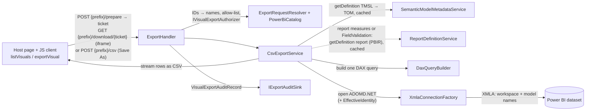

# Copilot / AI-agent instructions — PbiVisualExport

> Curated context for AI coding agents (GitHub Copilot, and any agent that reads
> `.github/copilot-instructions.md` or `AGENTS.md`). Read this first, then open the
> file named for the task in the **Task → file map** below. Keep changes surgical
> and match existing patterns. The user-facing integration guide is the root
> [`README.md`](../README.md); keep the two consistent.

## What this is

A **module** that exports a **selected Power BI visual to CSV**, bypassing the row
limits of the report's built-in "Export data". An existing ASP.NET Core back end
adds it with `AddPbiVisualExport()` + `MapPbiVisualExport("/pbi-export")`, and its
HTML front end loads the JS client (served at `{prefix}/client.js`) next to the
`Report` it already embeds.

The trick: the JS client gathers the visual's fields, active filters/slicers and
sort via the **Power BI Client JS API** and posts them with the workspace and
report **IDs**. The library resolves the dataset and all names from the workspace
catalog, loads the semantic model's metadata into a **TOM** model (data types,
format strings, sort-by columns, M parameters), builds **one DAX query**
(`SUMMARIZECOLUMNS` + optional `FORMAT()`), runs it over the workspace **XMLA
endpoint** with **ADOMD.NET**, and streams the rows to CSV as they arrive. XMLA has
none of the REST `executeQueries` row/value/byte caps, so there is **no paging** —
a 2M-row × 31-column export is a single query (~95 s formatted, ~86 s raw, vs
~1,220 s with the old executeQueries paging).

## Tech stack

- **Library** `src/PbiVisualExport`: ASP.NET Core minimal-API endpoints in a class
  library (`Microsoft.AspNetCore.App` framework reference), multi-targeting
  **net8.0 + net10.0**, **x64 only** (packed as the `PbiVisualExport` NuGet).
- **JS client** `src/pbi-visual-export-js`: TypeScript, built with esbuild into an
  ESM module and an IIFE (global `PbiVisualExport`), both embedded in the library.
  It uses the host's `powerbi-client` (+ `powerbi-report-authoring` for
  `getDataFields`); it has no runtime dependencies of its own.
- NuGet: `Azure.Identity` (auth),
  `Microsoft.AnalysisServices.NetCore.retail.amd64` (**TOM**, read model metadata),
  `Microsoft.AnalysisServices.AdomdClient.NetCore.retail.amd64` (**ADOMD.NET**, the
  XMLA data path). Power BI REST (catalog) is called with `HttpClient`; there's no
  `Microsoft.PowerBI.Api` dependency in the library (the sample uses it to embed).
- **Sample host** `samples/PbiVisualExport.SampleHost` (net10.0, MVC): embedding,
  report/visual pickers, debug panel, native-export comparison.
- **Tests** `tests/PbiVisualExport.Tests`: xunit, net8.0 + net10.0; JS tests with
  `node --test`.
- Infra/authoring: PowerShell + Fabric REST (`infra/`), plus `tools/WhSql`.

## Build, run, debug

```pwsh
az login                                                    # default dev credential (AzureCli)
$p = 'samples/PbiVisualExport.SampleHost'
dotnet user-secrets set PowerBI:WorkspaceId <workspace-guid> --project $p   # once
dotnet run --project $p                                     # http://localhost:5099

dotnet build PbiVisualExport.sln                            # library + sample + tests
dotnet test tests/PbiVisualExport.Tests                     # both TFMs
cd src/pbi-visual-export-js; npm ci; npm run build; npm test
```

- Requires the **.NET 10 SDK** (with the 8.0 runtime to run the net8.0 tests) and
  **Node 22+** for the JS client.
- **Stop a running SampleHost before building** — it locks the library's output.
- **`npm run build` writes `dist/` and copies the bundles to `src/PbiVisualExport/Client/pbi-visual-export.{js,mjs}`**
  (embedded resources served at `{prefix}/client.js|.mjs`). Commit them with the TS
  change: CI fails if the committed bundles differ from a fresh build.
- In dev mode the **first export** asks for a one-time XMLA device-code sign-in
  (the page shows the code; it is also logged as `XMLA DEVICE CODE`). See
  *XMLA credential* below.
- **`InvariantGlobalization` is false on purpose** — DAX `FORMAT()` and CSV output
  depend on culture-aware formatting. Don't flip it to true.
- `_sample/` holds the untouched upstream Microsoft sample — reference only
  (git-ignored).

### Tests and CI

- `GoldenDaxTests` compares the DAX generated for fixture requests
  (`Fixtures.cs`: the real TMDL models in `infra/models` and PBIR reports in `infra/reports`) with
  `Golden/*.dax`; each golden file was verified against the live model. After an
  **intended** DAX change: `$env:UPDATE_GOLDEN=1; dotnet test tests/PbiVisualExport.Tests`,
  review the diff, then commit. Never update goldens to paper over an unintended change.
- `EndpointTests` host the module in `TestServer` with fakes from `TestDoubles.cs`
  (catalog, metadata, XMLA) — no Power BI access needed.
- `.github/workflows/ci.yml` (Windows required; Ubuntu `continue-on-error`): JS
  build + tests + stale-bundle check, `dotnet build`/`test` (both TFMs), `dotnet
  pack`. Versions: `VersionPrefix` (csproj) must equal `version` (package.json);
  CI builds `{prefix}-ci.{run}`. **Release** = push tag `v{version}` → the `publish`
  job pushes the nupkg to GitHub Packages (`nuget.pkg.github.com/dbrownems`).

## Configuration (settings cascade)

Environment-specific IDs are **not committed**. The sample's `appsettings.json`
holds the keys (with empty IDs) and non-environment defaults. The standard ASP.NET
Core providers are layered; **later wins**:

| Layer | Loaded | Used for |
|---|---|---|
| `appsettings.json` | always | committed defaults, empty IDs |
| `appsettings.{Environment}.json` | if present (`appsettings.Development.json` is git-ignored) | optional local tweaks |
| **User secrets** (`<UserSecretsId>` in the sample csproj) | **Development only** | the local secret store: this dev box's IDs |
| **Environment variables** (`Section__Key`) | always | deployed: App Service settings, containers; Key Vault references also arrive this way |
| Command line (`--Section:Key value`) | always | one-off overrides |

- **Module settings** live under `PbiVisualExport` (`PbiVisualExportOptions.cs`;
  full table in the README's *Configuration reference*). The host passes the
  section to `AddPbiVisualExport(section, configure?)`. Options are validated at
  startup (`PbiVisualExportOptionsValidator`, `ValidateOnStart`): the XMLA
  endpoint, empty GUIDs in `AllowedWorkspaceIds`, non-positive ticket lifetime,
  negative `MaxRows`, and the settings each credential mode needs (skipped when
  the host calls `UseCredential`).
- **Sample settings** live under `PowerBI` (`PowerBIOptions.cs`): `WorkspaceId`
  (required, validated at startup with a message naming the fix; the sample adds
  it to `AllowedWorkspaceIds`) and `ReportId` (optional first report).
- `dotnet run` uses `launchSettings.json` (Development, port 5099). The built exe
  defaults to **Production**, so no user secrets load; pass `--environment
  Development` (`infra/perf-export.ps1` does).

Local setup (values live in
`%APPDATA%\Microsoft\UserSecrets\7ad05434-b6db-4caf-8ad0-a97c908c87ae\secrets.json`,
outside the repo):

```pwsh
$p = 'samples/PbiVisualExport.SampleHost'
dotnet user-secrets set PowerBI:WorkspaceId <workspace-guid> --project $p
dotnet user-secrets set PbiVisualExport:Credential:TenantId <tenant-guid> --project $p  # optional in AzureCli mode
dotnet user-secrets set PowerBI:ReportId <report-guid> --project $p                     # optional
```

Deployed with a service principal (app settings or environment variables):

```
PbiVisualExport__Credential__Mode         = ServicePrincipal
PbiVisualExport__Credential__TenantId     = <tenant-guid>
PbiVisualExport__Credential__ClientId     = <app-registration client id>
PbiVisualExport__Credential__ClientSecret = <secret>   # prefer @Microsoft.KeyVault(SecretUri=...) on App Service
PbiVisualExport__AllowedWorkspaceIds__0   = <workspace-guid>
PowerBI__WorkspaceId                      = <workspace-guid>   # sample only
```

(`MasterUser` uses `Username` / `Password` with `ClientId` in place of the secret.)

- `Credential:XmlaClientId` (`cf710c6e-…`) and the Azure CLI client ID used by the
  tools are **Microsoft's well-known public clients**, the same in every tenant.
  They stay committed.
- When adding a module setting: add it to `PbiVisualExportOptions.cs` (with an XML
  doc comment), to the validator if it can be invalid, to the sample's
  `appsettings.json` (with a `"// Key"` note) and to the README's configuration
  table. Never commit a real environment value.

## Authentication model (important)

All tokens come from **one `TokenCredential`**: the host's (`UseCredential(credential,
xmla?)`, registered as `HostCredentials`), or one built by `Auth/PbiTokenProvider.cs`
from `PbiVisualExport:Credential:Mode`:

| Mode | Credential | Use |
|---|---|---|
| `AzureCli` (default) | `AzureCliCredential` | Dev "super user" — whoever ran `az login`. |
| `ServicePrincipal` | `ClientSecretCredential` | Deployment. Needs `TenantId`/`ClientId`/`ClientSecret`. |
| `MasterUser` | `UsernamePasswordCredential` | Legacy master-user embedding. |
| `DeviceCode` | `DeviceCodeCredential` | Headless / no browser. Watch the log for the code. |

**Two token audiences, do not mix them up:**
- **Power BI** (`https://analysis.windows.net/powerbi/api/.default`) — the
  report/dataset catalog and the **XMLA** data path (and embedding, in the sample).
- **Fabric** (`https://api.fabric.microsoft.com/.default`) — `getDefinition`
  (the metadata path: `FabricDefinitionClient`, for semantic models and reports).

A Power BI-audience token will fail Fabric item calls with `InsufficientScopes`,
and vice-versa. `PbiTokenProvider.GetPowerBiTokenAsync` / `GetFabricTokenAsync`
already pick the right one — reuse them.

The identity needs **Contributor** or higher on each workspace (`getDefinition`
requires read + write permission on the item; it's also blocked for models with an
encrypted sensitivity label), and the workspace needs Premium/Fabric capacity with
**XMLA read** enabled.

### XMLA credential (`Auth/XmlaTokenProvider.cs`)

The XMLA endpoint **rejects Azure CLI tokens** ("Authentication failed for all
authenticators") even though the REST APIs accept them. So the data path has its
own credential, chosen by `PbiVisualExport:Credential:XmlaMode`:

| Mode | Behaviour |
|---|---|
| `Auto` (default) | `DeviceCode` when the main mode is `AzureCli` (or `DeviceCode` without a `ClientId`); otherwise `Shared`. |
| `Shared` | Reuse the main (or host) credential — the **deployment** path. |
| `DeviceCode` | Device-code sign-in with `Credential:XmlaClientId` (default `cf710c6e-dfcc-4fa8-a093-d47294e44c66`, the Analysis Services public client ADOMD.NET itself uses). |

Dev device-code flow is **non-blocking**: the first export (or `prepare`) returns
**HTTP 503** `{ error, signInRequired: true, verificationUri, userCode }`; the JS
client raises `PbiExportError` code `signInRequired`, the page shows the code and
calls `exporter.waitForSignIn()` (polls `GET {prefix}/xmla-auth` until
`signedIn`), then the user re-runs the export. The refresh token is kept in an
MSAL persistent cache (`PbiVisualExport.Xmla`) plus an `AuthenticationRecord` at
`%LOCALAPPDATA%\PbiVisualExport\xmla-auth-record-{clientId}.json`, so later
requests and restarts are silent. ADOMD's `OnAccessTokenExpired` re-mints tokens
for exports that outlive one.

> For a service principal (or managed identity) the tenant setting "Service
> principals can use Fabric APIs" must allow it (~15 min to propagate) and it must
> be added to the workspace. Otherwise expect `Unauthorized` (tenant setting) or
> `RequestFailed` (not in workspace).

## Architecture — export flow



## Repository layout

```
PbiVisualExport.sln                        library + sample + tests
src/PbiVisualExport/                       the library (NuGet)
  PbiVisualExportServiceCollectionExtensions.cs  AddPbiVisualExport, PbiVisualExportBuilder (UseCredential,
                                           AddAuthorizer, AddEffectiveIdentity, AddAuditSink), options validator
  ExportEndpoints.cs                       MapPbiVisualExport route group (RequireAuthorization by default)
  Extensibility.cs                         public seams: VisualExportContext, IVisualExportAuthorizer,
                                           IEffectiveIdentityProvider/EffectiveIdentity, IExportAuditSink/audit record
  PbiVisualExportOptions.cs                options (Credential, AllowedWorkspaceIds, XmlaEndpoint, Export, Downloads, MetadataCache)
  Models.cs                                wire contract: VisualExportRequest, ExportField, ExportSort, ReadBenchmarkResult
  README.md                                the package README (packed into the nupkg)
  Client/pbi-visual-export.{js,mjs}        built JS client (generated by npm run build; embedded resources)
  Auth/PbiTokenProvider.cs                 credential factory + PBI/Fabric token minting
  Auth/XmlaTokenProvider.cs                XMLA credential (Shared, or non-blocking dev device-code sign-in)
  Services/
    ExportHandler.cs                       endpoint logic: read/resolve, prepare, stream, tickets, status, errors, audit
    ExportRequestResolver.cs               IDs → catalog names, ID/name agreement, allow-list, authorizer → VisualExportContext
    DownloadTickets.cs                     DownloadTicketStore (one-time tickets, status) + ExportConcurrencyLimiter
    PowerBiCatalog.cs                      cached workspace/report/dataset lookups (REST)
    CsvExportService.cs                    orchestrates: metadata → field validation → DAX → XMLA reader → CSV stream
    VisualFieldValidator.cs                FieldValidation: request fields ⊆ the visual's saved PBIR fields
    DaxQueryBuilder.cs                     VisualExportRequest + TOM (+ report measures) → single DAX query (DaxPlan)
    FabricDefinitionClient.cs              Fabric getDefinition POST + 202/LRO poll → decoded parts
    SemanticModelMetadataService.cs        semantic model getDefinition(TMSL) → TOM
    ReportDefinitionService.cs             report getDefinition → ReportDefinition (format, parts, report measures)
    MetadataCache.cs                       in-memory + single-flight + on-disk definition cache
    XmlaConnectionFactory.cs               ADOMD.NET connections (names only) + EffectiveUserName/Roles/CustomData
    ClientScript.cs                        serves the embedded client (ETag, no-cache)
    ExportRequestException.cs              a request that can't be exported as sent → 400/403
src/pbi-visual-export-js/                  the JS client (see its README)
  src/index.ts                             createExporter / Exporter (listVisuals, buildRequest, exportVisual, menu command, sign-in)
  src/gather.ts                            fields, filters (+ slicer/bookmark fallbacks), sort from the bookmark
  src/transfer.ts                          Save As (File System Access) and ticket download (hidden iframe + status polling)
  src/http.ts, errors.ts, types.ts         fetch wrapper (contract header), PbiExportError codes, public types
  test/                                    node --test with a mocked powerbi-client
samples/PbiVisualExport.SampleHost/        reference host (embedding is the host's job)
  Program.cs                               the wiring (UseRouting → UseAuthorization; AllowAnonymous because no sign-in)
  Services/PbiEmbedService.cs, Controllers/EmbedInfoController.cs   /embedinfo/reports, /embedinfo/getembedinfo?reportId=
  Views/Home/Index.cshtml, wwwroot/js/app.js                        pickers, Export, debug panel, Native export
tests/PbiVisualExport.Tests/               xunit (golden DAX, unit, TestServer endpoint tests)
infra/                                     Fabric authoring (see infra section)
tools/                                     WhSql (seed Warehouse)
_sample/                                   upstream MS "Embed for your customers/AppOwnsData" clone (git-ignored)
```

## The export pipeline, file by file

- **JS client** (`src/pbi-visual-export-js`). `createExporter({ report, apiBase,
  headers?, credentials? })` works with the host's embedded `Report`:
  - `listVisuals()` lists exportable visuals on visible pages (skipping
    `SKIP_VISUAL_TYPES`: textbox, image, shape, actionButton, basicShape, card,
    bookmarkNavigator, filter).
  - `buildRequest(visual, { formatted, sort })` → `VisualExportRequest`:
    - **Fields** (`gatherFields`): `getCapabilities` + `getDataFields(role)` per
      role, in role order — which reflects in-session reorders. `hidden: true` =
      hidden on the visual.
    - **Filters** (`gatherFilters`): visual + page + report filters + the page's
      slicer states. Slicers on a page that isn't rendered throw
      `visualConfigIsNotInitialized`, so the client **activates the visual's page**
      and retries. The SDK serializer also throws on some slicers (no saved
      selection → `reading 'general'`; a slicer in the interactive "Select all" state →
      `slicerSerializationFailed`); the slicer is then looked up in the captured bookmark
      (`singleVisual.objects.merge.general[].properties.filter`): no filter there =
      no selection; otherwise the semantic query is translated (`queryFilters`), and
      anything untranslatable **aborts** the export (`slicerUnreadable`; dropping a
      slicer would silently over-export).
    - **Filter-pane cards**: a card in the "Select all" state makes `getFilters()`
      reject with `undefined` for its **whole level** (report, page or visual), so
      every other card at that level would be lost too. `levelFilters` then reads the
      level from the bookmark: `explorationState.filters`,
      `.sections[page].filters`, `.sections[page].visualContainers[visual].filters`
      (`byExpr[]`; a card with no selection has no `filter`). An unreadable bookmark or
      untranslatable card aborts (`filtersUnreadable`).
    - **Bookmark translation** (`queryFilters`, one basic filter per `Where`
      condition): `Comparison` (`ComparisonKind 0`) of a column with `AnyValue` =
      "Select all" (slicer or filter-pane card on a column bound to a dynamic M
      parameter), sent as `{ operator: "All", values: [], selectAll: true }` (the
      marker is needed: an SDK `All` filter can't be told apart from no selection);
      `In` / `Not(In)` over one column with literal rows = `In` / `NotIn`. Literals:
      `'text'` (`''` escapes), `3L`, `1.5D`/`1.5M`, `true`/`false`, `null`,
      `datetime'2024-01-11T00:00:00'` (report-local wall time, no offset; the server's
      `ClientTime` reads it as is). Measure/comparison/Top N/relative-date conditions,
      tuples and subqueries aren't translated (abort).
    - **Time zone** (`browserTimeZone`): the browser's IANA zone, sent as `timeZone`.
      The SDK serializes date filter values with `toISOString()` — the local wall time
      as a UTC instant (local 2024-02-01 00:00 at UTC-6 → `…T06:00:00.000Z`) — and the
      report filters on the wall time, so the server converts back (`ClientTime`).
    - **Sort** (`gatherSort`): not exposed by any SDK getter, so it's read from
      `report.bookmarksManager.capture({allPages:true})` (`state` = base64 gzip JSON
      → `explorationState.sections[page].visualContainers[visual].singleVisual.orderBy[]`).
      That array holds the live sort **and** the saved PBIR `sortDefinition`; absent =
      no explicit sort. Hierarchy-level keys are skipped.
    - `formatted` (default true) → `applyFormatStrings`; `sort` (default **false**) →
      `applySort`.
  - `exportVisual(visual, { target })` transfers the file without buffering it:
    - `file` (`showSaveFilePicker`, Chromium): called *first*, while the click still
      counts as a user gesture → real Save As dialog, then `fetch POST csv` and
      `resp.body.pipeTo(writable)`. Dismissing the dialog resolves `{ status: "cancelled" }`; an `AbortSignal` rejects with code `aborted`. On failure
      the picked file is removed only if still empty (`discardFile`).
    - `download`: `POST prepare` (validation, planning, XMLA token — errors and the
      sign-in flow surface as JSON), then a hidden iframe navigates to
      `download/{ticket}`; the browser's download manager applies
      `Content-Disposition`. Progress/outcome come from polling
      `download/{ticket}/status`. The frame is kept (removing it can cancel the
      download).
    - `auto` (default): `file` where available, else `download`.
  - `addVisualMenuCommand()` adds "Export all data (CSV)" to visual context menus
    (replaces `settings.extensions`); menu clicks have no user gesture, so they always
    use `download`.
  - Every response carries `X-PbiVisualExport-Contract`; the client warns (via
    `onWarning`) only when it's present and differs from its own version.
- **`ExportHandler`** (behind `MapPbiVisualExport`):
  - `csv` and `prepare` read the JSON body (415 unless `application/json` — the
    CSRF guard), then `ExportRequestResolver.ResolveAsync` (below).
  - `prepare` also runs `CsvExportService.PlanAsync` (cached metadata, field
    validation, DAX build) and the XMLA token check, checks the per-user concurrency
    limit, and issues a ticket: `{ fileName, columns, sort, reportMeasures,
    measureFilters, parameters, warnings, ticket, ticketExpiresInSeconds, workspaceName,
    datasetId, datasetName, reportName }`. (`parameters` are the dynamic M parameter
    values it sets, e.g. `RegionParam = "West"`; their values are validated when the
    query runs, so a bad value fails the download, reported through its status.)
  - `download/{ticket}` is anonymous (a navigation can't send auth headers); the
    ticket is single-use, expires after `Downloads:TicketLifetimeSeconds`, and is
    bound to the user key of `prepare` — an authenticated download by someone else
    is 403. Status is kept for `StatusRetentionMinutes`. Tickets are **in memory**
    (multiple instances need session affinity).
  - `StreamAsync` (shared by `csv` and `download`): concurrency lease (429), then
    `Content-Disposition` via `ContentDispositionHeaderValue.SetHttpFileName` (ASCII
    `filename=` + UTF-8 `filename*`; Kestrel rejects raw non-ASCII header values),
    `Cache-Control: no-store`, `nosniff`, and `CsvExportService.ExportAsync` straight
    into `Response.Body`. Errors before the first byte → clean JSON 400/403/503/500
    (`Response.Clear()`); errors mid-stream rethrow and **abort the connection**
    (never a silently truncated file). Every stream ends with an audit record to all
    `IExportAuditSink`s (failures logged and ignored).
  - User key: `user:{oid | objectidentifier | nameidentifier | sub | name}` claim,
    else `anon:{remote IP}`.
  - An `ExportRequestException` from planning (a field that's in neither the model
    nor the report's measures, a non-PBIR report with report measures, a visual with
    no exportable fields) → **400** `{error}`; field validation → **403**
    `{error, problems}`.
- **`ExportRequestResolver`**: `workspaceId` and `reportId` are required GUIDs.
  The workspace must be in `AllowedWorkspaceIds` (when non-empty) → else 403. The
  report is looked up in the workspace catalog (`PowerBiCatalog`, cached), which
  supplies the **dataset ID** and the **workspace, dataset and report names**; any
  of those the client sent must match (case-insensitive) or it's a 400. This matters
  because metadata is fetched **by ID** (Fabric) but data **by name** (XMLA) — a
  mismatch would silently mix two models. Then `IVisualExportAuthorizer`
  (default `AllowListAuthorizer`: an empty list denies everything) → 403 on deny.
- **`VisualFieldValidator`** (`Export:FieldValidation`, default `Strict`): loads the
  (cached) report definition and requires the request's page + visual to exist in
  the **saved PBIR** definition, and every output field to be one of that visual's
  fields (same column, measure, or aggregation of a column, in any role, including
  `fieldParameters`). Otherwise 403 — so a caller can't use the module's identity to
  read arbitrary columns. Sort keys outside the visual (and its saved sort) are
  dropped with a warning. A miss triggers one refresh-on-miss. `PbirOnly` exports
  PBIR-Legacy reports unchecked; `Off` trusts the request. Filters are never
  restricted (they only narrow rows), but a filter on a column bound to a dynamic M
  parameter also picks the data the source query reads: see **Dynamic M query
  parameters** below.
- **`CsvExportService`** plans the query (`PlanAsync`, see **Report-level
  measures** below), opens an ADOMD.NET connection via `XmlaConnectionFactory`, runs the **single**
  query with `ExecuteReader`, writes a UTF-8 (BOM) header row, and streams each row,
  flushing every 16k rows — memory stays flat at any size (see **Performance**
  below). `Export:MaxRows` > 0 wraps the query in `TOPN`;
  `Export:CommandTimeoutSeconds` 0 = no timeout. Raw values are written
  culture-invariant with full precision (`double` round-trip `R`, exact
  `decimal`/`long`, ISO-8601 datetimes, `true`/`false`, BLANK → empty).
- **`DaxQueryBuilder.Build`** returns a `DaxPlan`; `BuildQuery(maxRows)` emits
  `DEFINE [MEASURE …] VAR _summ = SUMMARIZECOLUMNS(...) EVALUATE SELECTCOLUMNS(_summ, "c0", ..., "c1", ...)`:
  - Dimension columns → `SUMMARIZECOLUMNS` group-by; measures / implicit
    aggregations → extension columns `m_0, m_1, …`. Output columns get positional
    aliases `[c0]…` in **visual order** — dims and measures interleaved exactly as
    the visual shows them (CSV headers come from `DaxOutputColumn.Header`).
  - **Row order** (`applySort`, default on) → `ORDER BY` after `SELECTCOLUMNS`
    (or `TOPN(n, …, key, 0|1)` when `MaxRows` caps). Sort keys are always **raw**
    values: if the output column is `FORMAT`-ted, a hidden `[sN]` column carries
    the raw value (it isn't written to the CSV). A sort on a measure/aggregation
    not in the visual is added as a sort-only extension column; a column's model
    `SortByColumn` is honored (added to the group-by). With **no explicit sort**,
    Power BI's implicit order isn't reproducible exactly; we approximate with the
    visual's dimension columns ascending in visual order ("implicit default").
    `ORDER BY` makes the engine materialize and sort the whole result before the
    first row: on 2M × 31 `detail1` (formatted, Release), first byte 41.6 s / total
    215 s sorted vs 1.3 s / 95 s unsorted — hence the toggle. (Sorted formatted
    exports also stream the hidden raw `[sN]` keys, roughly doubling the wire width.)
  - Model **format strings** applied with DAX `FORMAT(...)` only when the column/
    measure **has** one and `applyFormatStrings` is true (strings pass through).
  - **Hidden fields** — two unrelated kinds:
    - **Model-hidden** (TOM `IsHidden`) columns/measures placed on a visual are
      displayed by the visual and included by native export, so they're exported
      like any other field. A grouping column must never be dropped: it would
      merge rows and re-aggregate every measure (summary1 + `Internal Hash`,
      filtered to 100 rows: 100 rows with it vs 20 without).
    - **Hidden on the visual** ("Hide fields on the visual" / `visual.setFieldHidden`,
      reported by `getDataFields` as `hidden: true` → `ExportField.Hidden`): only
      measures/aggregations can be hidden (hiding a column fails with
      `FailedToSetFieldHidden`). They stay in `SUMMARIZECOLUMNS` — a measure
      affects which rows are non-blank — but aren't projected, matching native
      summarized export, which omits them.
  - **Filters** — the query mirrors the DAX Power BI itself generates (captured
    with a trace), all as `SUMMARIZECOLUMNS` filter arguments:
    - **Column targets** → `VAR _f{i}`: basic In/NotIn (`TREATAS` /
      `FILTER(ALL(...))`) and advanced comparison conditions.
    - **Top N** (`#topN`, `filterType 5`) → `VAR _tn{i} = TOPN(n, SUMMARIZECOLUMNS(col,
      _f*, "tn", orderBy), [tn], 0|1)` (0 = Top, 1 = Bottom; ties kept). Each Top N is
      ranked under the column filters only, independently of other Top N/value filters.
    - **Value filters** on a **measure** (`{table, measure}`) or **implicit measure**
      (`{table, column, aggregationFunction}`) → one `VAR _vf = FILTER(KEEPFILTERS(
      SUMMARIZECOLUMNS(dims, _f*, _tn*, "m_i", …, "vf_j", IGNORE(expr))), pred && …)`,
      evaluated at the **visual's grain**. A measure the visual shows reuses its `[m_i]`;
      a filter-only one is an `IGNORE`d `[vf_j]` (IGNORE keeps it from affecting
      blank-row elimination). All value filters are ANDed; a card's own conditions use
      its `logicalOperator`. `_vf` then filters `_summ` like any table, so the result
      is Power BI's two-pass evaluation (e.g. an `ALLSELECTED` % of total sees the
      value filter), not a post-filter of `_summ`.
    - Filter cards with no conditions (`conditions: []`, `itemCount: 0`) are ignored.
      A filter measure must exist in the model or the report's measures (report
      measures are defined via `DEFINE MEASURE` like visual ones), else **400**.
      `prepare` returns the applied value/Top N filters as `measureFilters`.
    - Cost: `_vf` must be materialized before the first row. On 2M × 31 `detail1`
      with a filter-only `[Total Sales] > 100`: first byte 9.8 s vs 1.2 s, total
      96.2 s vs 92.4 s (still = read time); memory unchanged.
    - Before this, an implicit-measure target was mistranslated as a filter on the
      raw column's values; it now filters the aggregate.
    - **Hierarchy** targets (hierarchy slicers `filterType 9`, tuple filters
      `filterType 6`) are skipped with a warning (a known gap).
    - **Date/time values** in filters go through `ClientTime`: a value with an offset
      or `Z` is converted to the wall time in the request's `timeZone` (IANA; unknown
      zone → 400; absent → read as UTC), a value without one is used as written. Before
      this, every date filter was off by the UTC offset (an `In 2024-01-11` basic filter
      matched nothing). Verified against native on DqParamReport: `In`, `>=`, `<` on
      `Sales[SaleDate]`, and Date/DateTime parameters.
    - **Dynamic M query parameters.** A named expression with `ParameterValuesColumn`
      (TMDL `parameterValuesColumn`) is bound to that column; a filter or slicer on
      the column also sets the parameter, as Power BI's own query does (traced):
      `DEFINE MPARAMETER 'Name' = value` lines come **first**, and the column filter
      (`_f{i}`) stays. The value is a scalar for a single-value binding and a list
      `{…}` (even for one value) when the bound column's `ParameterMetadata` extended
      property has `supportsMultipleValues: true`. Only selections of values bind:
      basic `In`, or advanced `Is` conditions (`Or` = union, `And` = intersection);
      several filters on the column intersect. `All` or an empty selection leaves the
      parameter at its default (no `MPARAMETER`), as Power BI does for a slicer's saved
      state. An `All` filter marked `selectAll: true` (the client's "Select all") sets
      the binding's `selectAllValue` from `ParameterMetadata` (`{value}` when
      multi-select, as Power BI does — traced: `{"__SelectAll__"}`); no `selectAllValue`
      → 400; explicit values on the same column replace it. `NotIn`, comparisons, an empty
      intersection, or several values on a single-value parameter → **400** (native
      export fails on those too). Date parameters are `DATE(y, m, d)`, date-time ones
      `(DATE(…) + TIME(…))` — both identical to Power BI's traced literals; M receives a
      datetime even for a `Type="Date"` parameter, so the model's M must use
      `DateTime.Date(param)`. With `Export:ValidateParameterValues` (default
      true) `CsvExportService` checks each parameter's values against the bound column
      (`EVALUATE EXCEPT({values}, VALUES(col))`, same connection) and rejects unknown
      ones (400); the select-all value (`MParameterValue.SelectAll`) is skipped, since
      it comes from the model, not the client. Power BI does no such check: it passes any value to the source
      (traced: `"Nowhere"` reached the SQL `WHERE`). Before this, the parameter was
      never set: every export read the parameter's default (e.g. East) whatever the
      slicer said.
- **`XmlaConnectionFactory`** — XMLA addresses by **name only**:
  `Data Source = {PbiVisualExport:XmlaEndpoint}/{workspace name}`, `Initial Catalog =
  {semantic model name}` (GUIDs are rejected). Workspace needs Premium/Fabric
  capacity with XMLA read enabled.
- **`FabricDefinitionClient`** POSTs Fabric `.../{itemPath}/getDefinition[?format=]`
  (Fabric-audience token), handles the 202 + LRO poll (`Location` → `…/result`) and
  returns the base64-decoded parts. Shared by the two definition services.
- **`SemanticModelMetadataService`** downloads `semanticModels/{id}` as TMSL and
  takes the `model.bim` part. It owns only the **download** and parse; storage is
  delegated to **`MetadataCache`** (kind `tmsl`). Parsing **must** pass
  `CompatibilityMode.PowerBI` to `JsonSerializer.DeserializeDatabase` — the default
  (AnalysisServices) mode rejects Power BI-only properties (e.g. a field parameter's
  `relatedColumnDetails`) with "Unrecognized JSON property". `GetModelAsync(workspaceId, datasetId,
  maxAge, ct)` — `maxAge` null = the TTL, `TimeSpan.Zero` = bypass all cache layers.
- **`ReportDefinitionService`** downloads `reports/{id}` **without** `format`
  (`?format=PBIR` fails on legacy reports; we want to detect them, not fail the
  download), and caches (kind `report`) a JSON snapshot of the text parts
  (`StaticResources/` skipped): format + `path → text`. Parsed as
  `ReportDefinition`: `Format` (`PBIR` when a `definition/report.json` part exists,
  `PBIR-Legacy` for a root `report.json`, else `Unknown`), `Parts` (kept for future
  report-design features) and, for PBIR only, the `reportExtensions.json` measures.
- **`MetadataCache`** avoids re-downloading definitions on every export. Keyed by
  **(kind, item id)**; three layers, all governed by `MetadataCacheOptions`
  (`PbiVisualExport:MetadataCache` config section): (1) in-process parsed value (`TOM.Model` /
  `ReportDefinition`); (2) **single-flight** — a per-key `SemaphoreSlim` so
  concurrent misses download once; (3) **on disk** — the raw text is persisted
  (`%TEMP%\pbivisualexport-metadata-cache\{id:N}.{kind}.json`, i.e. `….tmsl.json`
  / `….report.json`) so a **restart** reuses it. Ages count from the **download**
  (a disk hit keeps the file's write time), so a restart doesn't extend the TTL.
  `TtlMinutes <= 0` = never expire. Cached values are **shared** and must be
  treated as read-only. Options: `Enabled`, `TtlMinutes` (60), `PersistToDisk`
  (true), `DiskCacheDirectory` (blank = temp), `RefreshOnMissSeconds` (60).
  - **Invalidation** is deliberately simple — models and reports change at planned
    deployments: entries expire after the TTL, and a field (or the column of an
    active filter) that can't be resolved
    triggers one re-download of any definition older than `RefreshOnMissSeconds`
    (so a just-deployed column/measure is picked up; repeated bad requests don't
    hammer Fabric). **The disk cache survives an app recycle** — after a deployment
    delete the cache folder (or run with `PersistToDisk=false`) to force a reload.
    (Filter columns count because a stale model can't translate such a filter, or
    see that it sets a newly bound M parameter.)
- **Report-level measures** (`CsvExportService.PlanAsync`). A report can define its
  own measures in `definition/reportExtensions.json` (enhanced PBIR); the JS client
  sends them like model measures (`{table, measure}` fields / sort entries). Flow:
  1. `DaxQueryBuilder.FindUnresolvedFields(request, model)` lists fields, sort
     measures, **measures named by active value/Top N filters** and **columns of
     active column filters** that the (cached)
     model lacks. None → build from the model alone; **the
     report definition is never downloaded** for such visuals.
  2. If any unresolved field is a **measure**, load the (cached) report definition
     and match it against the report's measures (case-insensitive; names are unique
     across model + report). Unknown columns never need the report.
  3. Still unresolved → refresh-on-miss (above), then re-check.
  4. Still unresolved → `ExportRequestException` (400): columns "not found in
     semantic model"; measures "not found in the model or the report's measures" —
     or, when the report isn't PBIR, "can only be read from a PBIR (enhanced
     format) report … save it in PBIR format and republish". A sort-only key that
     can't be resolved just adds a warning (as before).
  5. `Build(request, model, report)` emits each used report measure — plus the
     report measures it references (`references.measures` with `schema:
     "extension"`, or a `[Name]` token matching a report measure), dependencies
     first, cycle-safe — as a query-scoped `DEFINE MEASURE 'Entity'[Name] =
     <expression>` (the home `entity` must be a model table). Each expression is
     followed by a newline so a trailing `//` comment can't swallow the next line.
     Format string: the report measure's `formatString`.

## Front-end → back-end contract

`POST {prefix}/csv` and `POST {prefix}/prepare` body = `VisualExportRequest`
(`Models.cs`, contract version `ExportHandler.ContractVersion` = `1`, sent as the
`X-PbiVisualExport-Contract` response header; the JS client has the same constant
in `http.ts`). The TS mirror is `src/pbi-visual-export-js/src/types.ts` — change
both together, and bump the version on a breaking wire change.

```jsonc
{
  "workspaceId": "...",        // required
  "reportId": "...",           // required
  "datasetId": "...",          // optional; resolved from the report (checked if sent)
  "workspaceName": "...", "datasetName": "...", "reportName": "...",  // optional; checked if sent
  "pageName": "ReportSection1", "visualName": "table1",   // required under FieldValidation Strict
  "visualTitle": "DQ Sales",   // file name
  "fields": [
    { "table": "Sales", "column": "Category", "role": "Values" },
    { "table": "Sales", "measure": "Total Amount", "role": "Values" },
    { "table": "Sales", "column": "Amount", "aggregation": "Sum", "role": "Values" },
    { "table": "Sales", "measure": "Margin %", "hidden": true }  // hidden on the visual
  ],
  "filters": [ /* raw Power BI IFilter objects, parsed server-side */ ],
  "sort": [                    // visual's orderBy, in priority order ([] = implicit)
    { "table": "Sales", "measure": "Total Amount", "direction": "Descending" },
    { "table": "Sales", "column": "Amount", "aggregation": "Sum", "direction": "Ascending" }
  ],
  "applySort": true,           // server default true; the JS client sends false unless sort: true
  "applyFormatStrings": true,  // false = raw typed values
  "timeZone": "America/Chicago",  // browser's IANA zone for date filter values (optional)
  "sortSource": "bookmark"     // diagnostic only (ignored by the server)
}
```

- A slicer or filter-pane card in the "Select all" state arrives in `filters` as a basic
  `All` filter with an extra `selectAll: true` (additive; ignored except on an
  M-parameter binding).
- An `ExportField` is a **column** (`column`), a **measure** (`measure`), or a
  **column + implicit aggregation** (`column` + `aggregation`). `Header` is an
  optional server-side display override. `hidden` = hidden on the visual (computed,
  not output); model-hidden fields need no flag.
- Responses and status codes are listed in the README (*Endpoints and request
  contract*) and in the `ExportHandler` class comment.
- Sample-only routes (not part of the module): `/embedinfo/reports` and
  `/embedinfo/getembedinfo?reportId=` (note the `getembedinfo` segment); the
  embed-token response uses **`accessToken`** (not `embedToken`).

## Infra & Fabric authoring (`infra/`)

- **`deploy-model.ps1`** deploys a TMDL/PBIR folder as a Fabric item:
  `-Folder <dir> -DisplayName <name> -Kind semanticModels|reports [-Workspace <id>] [-WhatIf]`.
  It base64-encodes every part, POSTs `createItemWithDefinition`, polls the LRO,
  and prints the new item id. With `-ItemId <id>` it instead updates that item in
  place (`updateDefinition`); add `-UpdateMetadata` to also apply the `.platform`
  (e.g. a changed description). Uses `az account get-access-token --resource https://api.fabric.microsoft.com`.
  - **Workspace** defaults to the `PowerBI:WorkspaceId` setting through the same
    cascade as the app (see *Configuration*), via **`infra/settings.ps1`**: env var
    `PowerBI__WorkspaceId` > user secrets > web `appsettings.json`. Pass
    `-Workspace` to override it. The script prints which workspace it used.
  - **Deploy-time tokens** keep environment IDs out of `infra/`. Text parts are
    scanned; tokens are resolved **by display name in the target workspace** and
    substituted in the upload payload only. Files on disk are never rewritten.
    Unresolved, missing or ambiguous names stop the deploy before the POST. `-WhatIf`
    resolves and prints every token, then skips the POST.

    | Token | Resolves to | Used in |
    |---|---|---|
    | `{{SemanticModelId:<name>}}` | the semantic model's id (`/semanticModels`) | every `reports/*/definition.pbir` `byConnection.pbiModelDatabaseName` |
    | `{{WarehouseServer:<name>}}` | the Warehouse's `properties.connectionString` host (`/warehouses`) | `models/DqParamTest/definition/expressions.tmdl` (`WhServer`) |

    So a **fresh workspace** needs no file edits. Create the Warehouse (seed it with
    `tools/WhSql`), deploy the models, then the reports. The only thing that must
    line up is the model's display name. **Gotcha:** the `models/DqParamTest`
    folder's `.platform` says `DqParamTest`, but the deployed model is named
    **`DqParamReport`**. That's why `DqParamReport`'s pbir references
    `{{SemanticModelId:DqParamReport}}`. Keep the two consistent if you redeploy
    with a new name.
  - `infra/settings.ps1` is dot-sourceable from any script: `Get-PbiSetting
    'PowerBI:WorkspaceId' -Required`, or `Resolve-PbiSetting <key>` for
    `{Value, Source}`. It is Windows PowerShell 5.1-compatible, like the rest of
    `infra/`.
- **Test artifacts** (hand-authored to exercise the exporter). Reports are
  **modern enhanced PBIR** with documented `.platform` descriptions — see
  [`infra/reports/README.md`](../infra/reports/README.md) for the full report set,
  visual inventory, and the report-level-measure notes:

  | Folder | Exercises |
  |---|---|
  | `models/FieldParamTest` + `reports/FieldParamReport` | **Field parameter** (calc table with `ParameterMetadata`); self-contained M-literal tables (refresh with no credentials). |
  | `models/DqParamTest` + `reports/DqParamReport` | **Dynamic M query parameters** over a **DirectQuery** Warehouse: `RegionParam` (single value), `CategoryParam` (multi-select, `selectAllValue`), `FromDateParam` (Date) and `ToDateTimeParam` (DateTime) are bound to the Import picker tables `RegionPicker`/`CategoryPicker`/`DatePicker`/`DateTimePicker`, which `slicer1`–`slicer4` filter; the `Sales` native query folds all four into its `WHERE`. Golden case `dq-table1-mparameter-slicers`. |
  | `reports/StoreSales` | **Variety of visuals** (table, matrix, column/bar/line/donut charts, card, slicer) + **report-level measures** in `reportExtensions.json` (Page3 `rmTable`: two report measures, one built on the other, sorted by one). Default embedded report. |
  | `models/LargeExportTest` + `reports/LargeExportReport` | **Scale + data-type/format fidelity**: a deterministic **2M-row × 31-column** DAX calculated table (every data type, many format strings, CSV-hostile strings, BLANKs, > 2^53 int64, one hidden column). Both generated by **`generate-large-export.py`** — edit the spec there, never the output. |
  | `samples/` | `StoreSales.pbix`, `SalesAndReturns` + decoded `salesreturns_tmdl/` (reference PBIX/TMDL syntax). |

- **`compare-exports.py api.csv [native.csv] [--expect-rows N]`** checks an API
  export's integrity (unique/contiguous `Row Id`, column count) and diffs it cell
  by cell against a native (or other-mode) export keyed on `Row Id`. For type/
  format checks a **~2,000-row** native export is plenty; only row-count/scale
  checks need the full 2M.
- **`perf-export.ps1 -Request req.json [-Rows 100000,1000000,0] [-Formats formatted,raw] [-Sort] [-Repeat n]`**
  benchmarks the export against a read-only pass over the same XMLA query. It builds
  and starts the Release sample on port 5098 with `PbiVisualExport:Export:EnableBenchmark=true`, then
  interleaves `POST /pbi-export/bench` (execute + read every value, write nothing) and
  `POST /pbi-export/csv` (streamed to disk by curl), sampling the server's working set,
  private bytes and CPU. `-Rows N` adds `Orders[Row Id] <= N` (0 = all). Output
  (summary, per-run timelines, server log) goes to `%TEMP%\pbiexport-perf`. Uses
  the app's cached XMLA device-code sign-in, so sign in through the UI once first.

- **TMDL/PBIR notes** (proven in this repo):
  - TMDL uses **tab** indentation. Model parts under `definition/` are auto-included;
    only tables/cultures need explicit `ref` in `model.tmdl`. `relationships.tmdl`
    needs no `ref`. A `queryGroup:` on an expression requires the group to be
    declared, or deploy fails with `Workload_FailedToParseFile` — omit it if unused.
  - Dynamic M parameter: `expression RegionParam = "East" meta [IsParameterQuery=true, Type="Text", IsParameterQueryRequired=true]` in `definition/expressions.tmdl`.
    Bind it to a column with `parameterValuesColumn: RegionPicker.RegionChoice` on the
    expression; the bound column carries `extendedProperty ParameterMetadata =
    {"version":2,"kind":1}` (add `"supportsMultipleValues": true, "selectAllValue":
    "__SelectAll__"` for multi-select, and make the M accept a list). Use a
    **disconnected** picker table: filtering it has no effect except through the
    parameter. A `Type="Date"` parameter arrives in M as a **datetime** (Power BI sends
    `DATE(…)`), so wrap it: `Date.ToText(DateTime.Date(FromDateParam), …)`.
  - Field parameter: 3-column calc table, `source = { ("Label", NAMEOF('T'[Col]), 0), ... }`,
    in the Desktop shape: the label column (`[Value1]`) has
    `relatedColumnDetails` → `groupByColumn: 'Fields Fields'`; only the hidden value
    column (`[Value2]`, returns the field reference as text, e.g. `'Product'[Category]`)
    carries `extendedProperty ParameterMetadata = {"version":3,"kind":2}`. Without
    this shape the service treats the table as plain text and visuals never swap fields.
  - A visual driven by a field parameter lists the **expanded** fields in
    `queryState.<role>.projections` plus a `fieldParameters: [{ parameterExpr: <label
    column>, index, length }]` entry (see `FieldParamReport` `fpTable`). A slicer on
    the parameter targets the hidden `'Fields Fields'` column, e.g.
    `setSlicerState` with `values: ["'Product'[Segment]"]`.
  - `getDefinition?format=PBIR` **fails on PBIX-imported (PBIRLegacy) reports** — author modern PBIR from templates, don't round-trip legacy reports.
  - **Never put `"active": true` on a `tableEx` Values projection.** The table then
    renders **only that column** (the rest stay in the definition, so our API still
    exports them), and native `exportData` fails with "Visual has no data".
    `active` belongs only on drill levels (slicer, matrix Rows, chart Category).

- **`tools/`**: `WhSql` runs a `.sql` file against a Fabric Warehouse using a
  `https://database.windows.net/` token from the `SQLTOKEN` env var.

## Task → file map

| I want to change… | Start in |
|---|---|
| How fields/filters/sort are gathered in the browser | `src/pbi-visual-export-js/src/gather.ts` (then `npm run build`, commit the bundles) |
| Browser transfer (Save As / ticket download), client API | `src/pbi-visual-export-js/src/transfer.ts`, `index.ts`, `types.ts` |
| The generated DAX (grouping, format strings, filters) | `Services/DaxQueryBuilder.cs` (+ `Golden/*.dax`, `UPDATE_GOLDEN=1`) |
| CSV shape / streaming / row caps / raw value text | `Services/CsvExportService.cs` (+ `PbiVisualExportOptions.cs` `Export`) |
| Endpoints, status codes, tickets, audit | `ExportEndpoints.cs`, `Services/ExportHandler.cs`, `Services/DownloadTickets.cs` |
| Request validation (IDs ↔ names, allow-list, authorizer) | `Services/ExportRequestResolver.cs`, `Services/PowerBiCatalog.cs` |
| Which fields a caller may export | `Services/VisualFieldValidator.cs` (`Export:FieldValidation`) |
| Host extensibility (authorizer, RLS identity, audit) | `Extensibility.cs`, `PbiVisualExportServiceCollectionExtensions.cs` |
| Options / validation | `PbiVisualExportOptions.cs`, `PbiVisualExportOptionsValidator` (+ sample `appsettings.json`, README table) |
| XMLA connection / addressing / effective identity | `Services/XmlaConnectionFactory.cs` (+ `XmlaEndpoint`) |
| Metadata read (data types, M params, TOM) | `Services/SemanticModelMetadataService.cs` (download) / `Services/MetadataCache.cs` (caching) / `Services/FabricDefinitionClient.cs` (getDefinition + LRO) |
| Report-level measures / report definition | `Services/ReportDefinitionService.cs` (download, parse), `CsvExportService.PlanAsync` (resolution), `DaxQueryBuilder` (`DEFINE MEASURE`) |
| Auth mode / token audiences | `Auth/PbiTokenProvider.cs` (+ `PbiVisualExport:Credential`) |
| XMLA credential / device-code sign-in | `Auth/XmlaTokenProvider.cs` (+ `Credential:XmlaMode`, `XmlaClientId`) |
| Large test table / report | `infra/generate-large-export.py` (then redeploy), `infra/compare-exports.py` |
| Export throughput / memory | `infra/perf-export.ps1`, `CsvExportService.ReadOnlyAsync` (`POST {prefix}/bench`) |
| Sample page, report list / embed token | `samples/PbiVisualExport.SampleHost` (`wwwroot/js/app.js`, `Services/PbiEmbedService.cs`, `Controllers/EmbedInfoController.cs`) |
| Tests / CI / packaging | `tests/PbiVisualExport.Tests`, `src/pbi-visual-export-js/test`, `.github/workflows/ci.yml`, library csproj |
| Deploy a model/report to Fabric | `infra/deploy-model.ps1` |

## Conventions

- **Public surface stays small**: implementation types are `internal` (tests see
  them via `InternalsVisibleTo`). Hosts use the DI/endpoint extensions, the options
  and the `Extensibility.cs` seams. Adding public API = README + package README.
- **DI**: library services are registered in `AddPbiVisualExport` with `TryAdd*`
  (so a host or test can replace them): tokens, `XmlaConnectionFactory`, catalog,
  metadata/cache, DAX builder, tickets and limiter are singletons; the resolver,
  `CsvExportService` and `ExportHandler` are scoped. Follow that split. Never
  register library services in the sample.
- Nullable + implicit usings are **on**; warnings should stay at zero. Prefer
  `sealed` classes and records for DTOs (matches existing style).
- Config is strongly typed via `IOptions<PbiVisualExportOptions>` — add settings
  there, don't read `IConfiguration` ad hoc.
- Keep secrets and environment IDs out of source.
- Validate real changes by running the sample and exporting a visual (compare with
  the **Native export** button / `infra/compare-exports.py`), plus the tests —
  don't just eyeball generated DAX.

## Known limitations / good first issues

Integration-level gaps (in-memory tickets, paths not yet verified live, sensitivity
labels) are tracked in the README's *Known gaps* table; the DAX/filter gaps are
detailed here.

- **Report-level measures** are supported for **PBIR (enhanced format)** reports
  only; a visual using a measure the model lacks, on a PBIR-Legacy report, fails
  with a 400 asking to convert the report. Report measures are read from
  `reportExtensions.json` `reportExtension/1.0.0` (`entities[].measures[]`). A
  value/Top N *filter* on a report measure works too (filter-only report measures
  are pulled into `DEFINE MEASURE`). (This is
  why every report in `infra/reports/` is authored in enhanced PBIR — see
  `infra/reports/README.md`.)
- **Field-parameter visuals** export correctly: the report engine expands the
  parameter, so `getDataFields` returns the selected real columns (e.g.
  `Product[Segment]`), and a visual that shows the parameter column itself groups
  on its `relatedColumnDetails` key (added implicitly by `DaxQueryBuilder`). The
  remaining gap is that CSV headers use the column name (`Product`) where native
  export uses the parameter label (`Product Name`); the SDK doesn't expose that
  label (`ExportField.Header` exists to carry it).
- **Dynamic M parameter bindings** are supported (see **Filters** above; verified
  against native export on DqParamReport: single/multi-select, interactive "Select
  all" on a slicer and on a filter-pane card (alone, and next to a card with a
  selection), Date and DateTime parameters). Gaps: a programmatic "Select all"
  (`setSlicerState` with `All`) fails with `invalidFilter`, so it was tested by
  clicking (the filter-pane state was then replayed with
  `bookmarksManager.applyState`, which only updates cards that exist). A bound slicer
  has no "all except" state (unchecking after "Select all" clears the selection).
  `NotIn`/comparison filters on a bound column are refused (400), as native export
  refuses them.
- Filter translation skips **hierarchy-level** filter targets (with a warning),
  including **hierarchy slicer** filters (`filterType 9`, `hierarchyData`): e.g.
  LargeExportReport `table3` exports 72 rows instead of 70 because its
  Region › Category slicer's North › Electronics exclusion is ignored. (Measure
  value filters and Top N are supported — see **Filters** above; verified against
  native export on StoreSales `table1`/`bar1`.) Relative date/time, Top N by a
  hierarchy level, and "tuple" filters are also untranslated. Native `exportData`
  fails ("Export visual data has failed") on `rmTable` (report measures), so its
  measure-filter results were checked against the unfiltered values instead.
- **Sort**: hierarchy-level `orderBy` expressions aren't mapped (skipped client-side);
  a sort on a column not in the visual is skipped with a logged warning. The
  implicit (no explicit sort) order is an approximation. Median/StdDev/Variance
  implicit aggregations fall back to `SUM` server-side (pre-existing gap).

### API vs native `exportData` (measured on LargeExportReport `detail1`, 2,000 rows)

Every row matches on `Row Id`; 18 of 30 columns are byte-identical. The rest
are expected, **by design** differences:

- **Native ignores most format strings** and applies its own: dates/times always
  `yyyy-MM-dd HH:mm:ss` (a `Time` column becomes `1899-12-30 04:04:36`), and
  numbers **without thousands separators** (`$33296.83` vs API `$33,296.83`). The
  API applies the model format string faithfully.
- **Native loses int64 precision above 2^53** (values pass through JS doubles:
  `9007199254741113` → `…112`). The API is exact.
- **Hidden columns**: at the time of this measurement the API omitted the
  model-hidden `Internal Hash` (18 of the 30 shared columns were byte-identical).
  It is now exported, as native does, and matched native in the summary1 grain test.
- **Rounding at exact halves**: the API's formatting is engine DAX `FORMAT()`,
  which rounds half away from zero on the decimal value (and appears to round to
  15 significant digits first), so `1.965E-06` → `1.97E-06` and
  `1024999999999.9999` → `1.03E+12`, where the native JS formatter gives
  `1.96E-06` / `1.02E+12`. Affects ~2.5% of `0.00E+00` cells in the test data.
  Use raw mode (`applyFormatStrings: false`) when full precision matters.
- Native export is capped (30k summarized rows in the embedded API, and a 30k
  request on this 31-column visual did not return within 15 minutes, while 2,000
  rows took 2.4 s); the API has no cap.

### Performance (measured with `infra/perf-export.ps1`, LargeExportReport `detail1`)

Release build, `applySort: false` unless noted; *read* = `POST {prefix}/bench`
(same query, every value read, nothing written); memory = peak of the server
process during the run.

| Rows | Mode | Read s | Export s | CSV MB | Peak working set | Peak private bytes |
|---:|---|---:|---:|---:|---:|---:|
| 100k | formatted | 7.3 | 7.4 | 31 | 172 MB | 49 MB |
| 500k | formatted | 27.7 | 25.1 | 156 | 171 MB | 47 MB |
| 1M | formatted | 48.5 | 47.7 | 312 | 179 MB | 52 MB |
| 2M | formatted | 98.1 | 94.8 | 625 | 178 MB | 51 MB |
| 2M | raw | 86.4 | 86.4 | 632 | 173 MB | 46 MB |
| 2M | formatted, sorted | 222.6 | 215.4 | 625 | 175 MB | 48 MB |

- **Export time = read time** (within ±3%, and within the run-to-run noise of the service);
  first CSV byte arrives in ~1–2 s unsorted.
- **Memory is flat**: peak working set/private bytes don't change from 31 MB to
  625 MB of output, and no gen2 GCs happen during an export. There's no
  data-sized buffer: `ExecuteReader` → one reused `StringBuilder` → 64 KB
  `StreamWriter` → `Response.Body` (no response buffering).
- **The bottleneck is the XMLA stream, not us**: the server uses ~0.4–0.6 of a
  core (of 16). Allocations are transient gen0 garbage, ~3.4 KB/row inside ADOMD.NET
  (identical in read-only mode) plus ~0.4 KB/row (formatted) / ~1 KB/row (raw
  `ToString`) for CSV text. Overlapping read and write, or span formatting, would
  only lower CPU, not wall time.
- **Browser side**: no buffering either. The Save As path pipes `resp.body`
  straight into the file. The fallback hands the response to the browser's
  download manager. Measured in the canvas (mock file handle, 2M rows / 625 MB
  formatted): the JS heap stayed ≤ 10 MB, at the same throughput as curl.

## Source control

The repo is a **private** GitHub repo, `dbrownems/PbiVisualExport`. The root
`.gitignore` excludes the following:

- **`bin/`, `obj/`, `__pycache__/`**
- **Local secrets**: `appsettings.*.local.json`, `appsettings.Development.json`,
  `secrets.json`
- **`nuget.config`**: the local copy clears all sources and points at the
  Microsoft package feed proxy
  (`https://packagefeedproxy.microsoft.io/nuget/v3/index.json`). Microsoft-managed
  devices block direct nuget.org and PyPI access. Other machines restore from
  nuget.org by default.
- **`_sample/`**: the upstream Microsoft clone, which has its own `.git`. To get
  it back, run
  `git clone https://github.com/microsoft/PowerBI-Developer-Samples _sample`
  and look under `.NET Core/Embed for your customers/AppOwnsData`.

## ⚠️ Before making this repo public

1. **App and infra config: done.** `appsettings.json` reads environment IDs
   from user secrets or env vars (see
   *Configuration*). `infra/` resolves them at deploy time: the workspace comes
   from the same cascade, and model ids and the Warehouse host come from
   `{{…}}` tokens (see *Infra*). Only public client IDs (Azure CLI, Analysis
   Services) and PBIR lineage/sample GUIDs remain.
2. **Git history**: the initial commit (`aa72a1d`) and later ones before the
   settings refactor contain the old IDs. They're IDs, not secrets. Squash or
   rewrite only if that matters, and only on explicit request.
3. **`LICENSE`** (MIT, Copyright (c) Microsoft Corporation) is already present.
