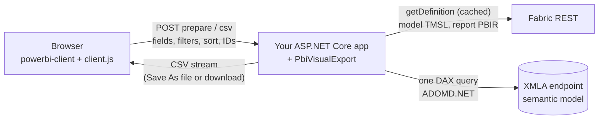

# PbiVisualExport

> [!NOTE]
> This is a **sample and reference implementation** for exporting Power BI visuals. It
> shows one way to export all the data behind a visual. Adapt it to your app, and review
> and test it against your own models, reports and security requirements before you use
> it in production. [Known gaps](#known-gaps) lists what it doesn't handle yet.

Export **all** the rows behind a visual in an embedded Power BI report to CSV,
bypassing the row limits of Power BI's own "Export data". It ships as a module for an
existing ASP.NET Core back end and HTML front end:

- **`PbiVisualExport`** (NuGet): an ASP.NET Core library. `AddPbiVisualExport()` plus
  `MapPbiVisualExport()` adds the export endpoints to your app.
- **`pbi-visual-export`** (JS): a browser client that works with the `Report` your page
  already embeds. The library serves it at `{prefix}/client.js`.

The browser gathers the visual's fields, filters, slicer selections and sort through
the Power BI JavaScript API. The server loads the semantic model's metadata into TOM
(data types, format strings, sort-by columns, M parameters) and builds **one DAX query**
that reproduces the visual. It runs the query over the workspace's **XMLA endpoint** and
streams the rows to the browser as they arrive. XMLA has no row or byte caps, so there's
no paging: a 2M-row × 31-column export is a single query. It takes about as long as
reading the XMLA result (~95 s formatted), and server memory stays flat (~50 MB private
bytes at any size).



- [Before you start](#before-you-start)
- [Try the sample](#try-the-sample)
- [Add it to your app](#add-it-to-your-app)
- [Security model](#security-model)
- [Configuration reference](#configuration-reference)
- [Endpoints and request contract](#endpoints-and-request-contract)
- [What gets exported](#what-gets-exported)
- [Known gaps](#known-gaps)
- [Development](#development)

## Before you start

Check these before you integrate. Each one is a hard requirement, and each fails in a
different way if it's missing.

| Requirement | Why | If it's missing |
|---|---|---|
| A **64-bit (x64)** .NET 8 or .NET 10 host process | ADOMD.NET and TOM ship x64-only. | The assemblies don't load. |
| The workspace on **Premium or Fabric capacity**, with **XMLA read** enabled | Data is read over the workspace's XMLA endpoint. | The XMLA connection fails. |
| The report and its semantic model in the **same workspace** | The server resolves the model from the report and reads both with one workspace's permissions. | 400. |
| The report saved in **enhanced PBIR** format | With the default `Export:FieldValidation` (`Strict`), requested fields are checked against the visual's saved PBIR definition. PBIR is also where report-level measures live. | 403 for a PBIR-Legacy report. Set `FieldValidation` to `PbirOnly` to export legacy reports unchecked. |
| The module's identity is **Contributor** (or higher) on the workspace | Fabric `getDefinition` needs read *and* write permission on the model and the report. | 403 from Fabric. |
| For a service principal or managed identity: the tenant setting *Service principals can use Fabric APIs* | Fabric and XMLA both check it. It takes about 15 minutes to apply after a change. | `Unauthorized`. |

Terms used below:

- **PBIR**: Power BI's file format for a report definition (pages, visuals, fields).
  *Enhanced* PBIR stores each visual as its own JSON part; PBIR-Legacy is the older
  single `report.json`.
- **TOM**: the Tabular Object Model, the .NET object model of a semantic model. The
  server reads data types, format strings and M parameters from it.
- **XMLA endpoint**: the Analysis Services protocol endpoint of a Premium or Fabric
  workspace. It runs DAX queries with no row or size cap.

## Try the sample

`samples/PbiVisualExport.SampleHost` embeds the reports in one workspace. It has a
visual picker, an **Export data** button, a debug panel showing the request JSON, and
a **Native export** button for comparing with Power BI's own export. You need the
.NET 10 SDK and the Azure CLI; dev mode uses your `az login` identity ("super user").

**1. A workspace with reports.** Use an existing workspace that has reports, or deploy
the sample content (the reports in [`infra/reports`](infra/reports/README.md), their
models and a seeded Warehouse) to a new one:

1. Create a workspace and assign it a Premium or Fabric capacity (in the Power BI
   portal: *Workspace settings > License info*).
2. Deploy everything (about 5 minutes; rerunning it updates the items in place):

   ```pwsh
   az login
   .\infra\deploy-all.ps1 -Workspace <workspace-guid>   # -WhatIf shows the plan first
   ```

   It creates and seeds the Warehouse `ExportTestWH`, deploys the models and reports,
   then refreshes the models.

**2. Run the host** with the workspace ID, from user secrets or an environment variable:

```pwsh
az login
$p = 'samples/PbiVisualExport.SampleHost'
dotnet user-secrets set PowerBI:WorkspaceId <workspace-guid> --project $p
# or, for this shell only: $env:PowerBI__WorkspaceId = '<workspace-guid>'
dotnet run --project $p                    # http://localhost:5099
```

`PowerBI:ReportId` (optional) picks the first report shown.

**3. Sign in for XMLA.** The first export asks for a one-time **XMLA device-code
sign-in**, because the XMLA endpoint rejects Azure CLI tokens. The page shows the code
(the export returns 503 with `signInRequired`), and the token is cached after that.
`GET http://localhost:5099/pbi-export/xmla-auth` shows the sign-in status.

**4. Smoke test** (sample content only). With the host running, this exports StoreSales
Page1 `table1` through the same endpoints the page uses and checks the result (4 rows,
4 columns). It prints the device code if XMLA sign-in is still needed:

```pwsh
.\infra\smoke-export.ps1
```

The sample has no user sign-in of its own, so it maps the endpoints with
`.AllowAnonymous()`. Don't copy that part.

## Add it to your app

### 1. Install

The package is published to this repo's GitHub Packages feed. Add the feed once, with a
personal access token that has `read:packages`:

```pwsh
dotnet nuget add source https://nuget.pkg.github.com/dbrownems/index.json -n dbrownems -u <github-user> -p <PAT>
dotnet add package PbiVisualExport --prerelease
```

It targets **net8.0 and net10.0, x64 only**, because the ADOMD.NET and TOM packages are
x64-only.

### 2. Server

```csharp
using PbiVisualExport;

builder.Services.AddPbiVisualExport(builder.Configuration.GetSection("PbiVisualExport"))
    .UseCredential(new ManagedIdentityCredential())   // optional; else PbiVisualExport:Credential
    .AddAuthorizer<MyExportAuthorizer>()              // optional; default = AllowedWorkspaceIds only
    .AddEffectiveIdentity<MyRlsIdentity>()            // optional; row-level security
    .AddAuditSink<MyAuditSink>();                     // optional; any number

var app = builder.Build();
app.UseRouting();            // if you call it explicitly
app.UseAuthentication();
app.UseAuthorization();      // after UseRouting: the endpoints carry authorization metadata

app.MapPbiVisualExport("/pbi-export")                 // RequireAuthorization() by default
   .RequireAuthorization("CanExportData");            // optional: a specific policy
```

- `MapPbiVisualExport` returns the `RouteGroupBuilder`, so you can chain rate limiting,
  CORS, or `WithTags` onto it.
- Options are validated at startup (`ValidateOnStart`), and a bad configuration fails
  with the setting name to fix.
- Use `AddPbiVisualExport(o => …)` to configure in code only.

**Credential.** The module calls three services: Power BI REST (workspace, report and
dataset names), Fabric `getDefinition` (model and report metadata), and the XMLA
endpoint (data). REST and Fabric always use the **main credential**. XMLA uses the
main credential too, except in dev, because the XMLA endpoint rejects Azure CLI
tokens. The first matching row decides:

| You configure | Main credential (REST, Fabric) | XMLA credential |
|---|---|---|
| `UseCredential(credential[, xmlaCredential])` in code | `credential` | `xmlaCredential`, else `credential` (`Credential:Mode`/`XmlaMode` are ignored) |
| `Credential:XmlaMode` = `Shared` | from `Credential:Mode` | the main credential |
| `Credential:XmlaMode` = `DeviceCode` | from `Credential:Mode` | a one-time device-code sign-in |
| `Credential:XmlaMode` = `Auto` (default) | from `Credential:Mode` | device code when `Mode` is `AzureCli`, or `DeviceCode` without a `ClientId`; otherwise the main credential |

`UseCredential` takes any Azure.Identity credential, such as a managed identity or the
service principal you already embed with. `Credential:Mode` is `ServicePrincipal`
(deployed), `MasterUser`, `DeviceCode`, or `AzureCli` (dev only); see the
[reference](#configuration-reference). The identity's permissions are listed in
[Before you start](#before-you-start).

### 3. Browser

```html
<script src="https://cdn.jsdelivr.net/npm/powerbi-client@2.23.1/dist/powerbi.min.js"></script>
<script src="https://cdn.jsdelivr.net/npm/powerbi-report-authoring@3.0.0/dist/powerbi-report-authoring.js"></script>
<script src="/pbi-export/client.js"></script>
<script>
  const report = powerbi.embed(container, embedConfig);        // your existing embedding
  const exporter = PbiVisualExport.createExporter({ report, apiBase: "/pbi-export" });
  report.on("loaded", () => exporter.addVisualMenuCommand());   // "Export all data (CSV)" menu item
</script>
```

For bearer-token APIs, pass `headers: async () => ({ Authorization: "Bearer " + token })`.
To build your own picker and button, use `listVisuals()` and `exportVisual(visual)`
from a click handler. See the [client README](src/pbi-visual-export-js/README.md) for
the full API, the transfer methods and the error codes.

Embedding stays your app's job. The module only needs the workspace and report IDs,
which the client reads from the embedded report.

### 4. Deploying

- **Scale-out**: download tickets and their status live in memory. Behind a load
  balancer with more than one instance, enable **session affinity** (for example ARR
  affinity on App Service). Otherwise `GET download/{ticket}` can land on an instance
  that never issued the ticket and returns 404.
- **Proxy timeouts**: exports stream from the first row, and unsorted exports produce
  their first byte in 1–2 s. With `sort: true`, the capacity sorts the whole result
  before the first row: 2M rows took 42 s. A proxy with an idle timeout (App Service:
  230 s) can cut off very large sorted exports.
- **Metadata cache**: definitions are cached in memory and on disk (default
  `%TEMP%/pbivisualexport-metadata-cache`), and the disk cache survives restarts.
  After you republish a model or report with changed fields, either delete the folder
  or rely on `RefreshOnMissSeconds`: an unknown field or filter column re-downloads
  definitions older than that.
- **Linux**: the build and tests pass on Linux. XMLA streaming on Linux hasn't been
  verified against a live workspace yet.

## Security model

The module reads data with **its own identity**, which is typically far more
privileged than the signed-in user. These layers decide what a caller can get:

| Layer | Default | Purpose |
|---|---|---|
| Endpoint authorization | `RequireAuthorization()` | Requires a signed-in user. Chain a policy for more. The download and client-script endpoints are anonymous by design (see below). |
| `AllowedWorkspaceIds` | empty | Rejects other workspaces (403) before any Power BI call. With the default authorizer, an empty list rejects everything; with your own authorizer, an empty list skips this check. |
| `IVisualExportAuthorizer` | the allow-list only | Your per-user decision, given the resolved workspace, report, dataset, page and visual names and IDs. |
| `Export:FieldValidation` | `Strict` | Only fields of the visual *as saved in the published report* can be exported, so a caller can't request other columns of the model (403). A visual bound to a field parameter can also export any field in the parameter. |
| `IEffectiveIdentityProvider` | none | Runs the query as the user (RLS) instead of the module's identity. |
| Concurrency limits | 2 per user | More than that returns 429. |

Details:

- **Filters aren't restricted.** The embedding API can apply any filter to the live
  visual anyway, and filters only remove rows. A filter on a column bound to a
  dynamic M query parameter also sets the parameter, which reaches the source query.
  The value is passed as a DAX literal, and by default it must be one of the bound
  column's values (`Export:ValidateParameterValues`). Power BI itself doesn't check
  this, so the M query must still treat parameter values as untrusted input.
- **Download tickets** are unguessable, single-use, expire after 60 s, and are bound to
  the user who called `prepare`. If the download request is authenticated, it must be
  the same user. The download is anonymous so that a plain iframe navigation can save
  the file without auth headers.
- **CSRF**: JSON endpoints require `Content-Type: application/json` (otherwise 415).
  A cross-site form can't send that without a CORS preflight, so cookie auth is safe
  unless your CORS policy allows arbitrary origins with credentials.
- **`POST bench`** (a perf baseline) is off unless `Export:EnableBenchmark` is true.

An authorizer, for example to check that the user's tenant owns the workspace:

```csharp
sealed class TenantAuthorizer(ITenantDirectory tenants) : IVisualExportAuthorizer
{
    public async ValueTask<VisualExportAuthorization> AuthorizeAsync(VisualExportContext ctx, CancellationToken ct) =>
        await tenants.OwnsWorkspaceAsync(ctx.HttpContext.User, ctx.WorkspaceId, ct)
            ? VisualExportAuthorization.Allow()
            : VisualExportAuthorization.Deny("This report belongs to another tenant.");
}
```

**Row-level security.** An `EffectiveIdentity` is applied as XMLA connection-string
properties:

- `EffectiveUserName`: an Entra UPN in the tenant, with Read and Build permission on
  the model.
- `Roles`: model roles. If the module's identity isn't a workspace admin, it must be a
  member of those roles itself.
- `CustomData`: passed through, but Power BI's XMLA documentation doesn't list it, so
  verify it in your tenant.

For "embed for your customers" users who aren't Entra accounts, map them to roles:

```csharp
sealed class CustomerRls : IEffectiveIdentityProvider
{
    public ValueTask<EffectiveIdentity?> GetEffectiveIdentityAsync(VisualExportContext ctx, CancellationToken ct) =>
        ValueTask.FromResult<EffectiveIdentity?>(new(UserName: null, Roles: ["Customer"]));
}
```

Match what your embed token grants. If the embed token applies RLS and the export
doesn't, the export shows more rows than the user can see in the report.

**Audit.** `IExportAuditSink.WriteAsync` receives a `VisualExportAuditRecord` for every
export that reaches the data step: a `csv` request, or a `download` with a valid ticket,
once it has a concurrency slot. That covers completed, failed and canceled exports,
including a `csv` request that fails planning (e.g. field validation). The record has
the user, the workspace, report, page and visual, the number of requested fields, the
rows written, the effective user name, the outcome and the duration. There's no record
for requests rejected before that (request checks, an invalid ticket, 429), for
`prepare`, or for `bench`. Sink failures are logged and ignored.

**Cross-origin API.** If the page and the API are on different origins, set `apiBase`
to the absolute URL, and add a CORS policy to the group:

```csharp
builder.Services.AddCors(o => o.AddPolicy("pbi-export", p => p
    .WithOrigins("https://app.contoso.com")
    .WithHeaders("Content-Type", "Authorization", "X-PbiVisualExport-Contract")
    .WithExposedHeaders("X-PbiVisualExport-Contract")
    .WithMethods("GET", "POST")));
// app.UseCors() after UseRouting, then:
app.MapPbiVisualExport("/pbi-export").RequireCors("pbi-export");
```

For cookie auth, add `.AllowCredentials()` and pass `credentials: "include"` to
`createExporter`. The Save As path (`fetch` + `pipeTo`) and the status polling need
CORS. The ticket download is a navigation, so it doesn't.

## Configuration reference

Section `PbiVisualExport` (environment variables use `__`, for example
`PbiVisualExport__Credential__Mode`; arrays use `__0`, `__1`, …):

| Key | Default | |
|---|---|---|
| `AllowedWorkspaceIds` | `[]` | Workspaces exports may read from. With the default authorizer, empty rejects every export. |
| `XmlaEndpoint` | `powerbi://api.powerbi.com/v1.0/myorg` | The workspace name is appended. Use a different base for sovereign clouds. |
| `Credential:Mode` | `AzureCli` | `AzureCli` (dev: your `az login`), `ServicePrincipal`, `MasterUser`, or `DeviceCode`. Ignored with `UseCredential`. |
| `Credential:TenantId` | | Required for `ServicePrincipal` and `MasterUser`. |
| `Credential:ClientId` / `ClientSecret` | | `ServicePrincipal` (`MasterUser` and `DeviceCode` use `ClientId`). Keep the secret in Key Vault or an environment variable. |
| `Credential:Username` / `Password` | | `MasterUser`. |
| `Credential:XmlaMode` | `Auto` | `Auto`: device code when `Mode` is `AzureCli`, or `DeviceCode` without a `ClientId`; else `Shared`. `Shared`: the main credential. `DeviceCode`: always (dev). Ignored when the host calls `UseCredential`. |
| `Credential:XmlaClientId` | `cf710c6e-…` | The public client for XMLA device-code sign-in: Microsoft's Analysis Services client, the same in every tenant. |
| `Export:FieldValidation` | `Strict` | `Strict`: fields must be in the visual's saved PBIR definition (or, for a visual bound to a field parameter, in the parameter), and PBIR-Legacy reports are refused. `PbirOnly`: PBIR-Legacy reports are exported unchecked. `Off`: trust the request. |
| `Export:MaxRows` | `0` | An exact cap on rows, where 0 means unlimited. The query uses `TOPN`, and the CSV stops at N rows (rows tied at the cut are dropped). |
| `Export:CommandTimeoutSeconds` | `0` | The XMLA command timeout, where 0 means none. |
| `Export:ValidateParameterValues` | `true` | Rejects (400) a filter that would set a dynamic M query parameter to a value missing from its bound column. Power BI passes such values to the source unchecked; `false` does the same. The model's own select-all value isn't checked. |
| `Export:MaxConcurrentExportsPerUser` | `2` | Above this, requests get 429. 0 means unlimited. |
| `Export:MaxConcurrentExports` | `0` | A process-wide limit (429 above it). 0 means unlimited. |
| `Export:EnableBenchmark` | `false` | Enables `POST bench`. |
| `Downloads:TicketLifetimeSeconds` | `60` | How long a ticket from `prepare` can be redeemed. |
| `Downloads:StatusRetentionMinutes` | `15` | How long a ticket's progress and result stay queryable. |
| `MetadataCache:Enabled` | `true` | |
| `MetadataCache:TtlMinutes` | `60` | Freshness of cached definitions. ≤ 0 means they never expire on their own. |
| `MetadataCache:PersistToDisk` | `true` | Keeps definitions across restarts. |
| `MetadataCache:DiskCacheDirectory` | `%TEMP%/pbivisualexport-metadata-cache` | |
| `MetadataCache:RefreshOnMissSeconds` | `60` | An unknown field or filter column re-downloads definitions older than this once. ≤ 0 disables it. |

## Endpoints and request contract

All paths are relative to the prefix passed to `MapPbiVisualExport` (default
`/pbi-export`). Responses carry `X-PbiVisualExport-Contract: 1`.

| Endpoint | Auth | |
|---|---|---|
| `POST prepare` | group policy | Validates and plans the export, then returns `{ ticket, ticketExpiresInSeconds, fileName, columns, sort, parameters, warnings, … }`. |
| `GET download/{ticket}` | anonymous (ticket) | Streams the CSV as an attachment. |
| `GET download/{ticket}/status` | anonymous (ticket) | `{ state, rows, error, fileName }`. |
| `POST csv` | group policy | Streams the CSV in the response (for `fetch` and programmatic callers). |
| `GET xmla-auth` | group policy | The device-code sign-in status. Returns 404 unless XMLA uses device code. |
| `POST bench` | group policy | A read-only baseline: runs the query, reads every value, writes nothing. Returns 404 unless enabled. |
| `GET client.js`, `client.mjs` | anonymous | The browser client. |

`prepare` and `csv` take the same body. Only `workspaceId` and `reportId` are required
for identity. The server resolves the dataset and all names from the workspace catalog,
and rejects any ID or name the client sends that disagrees with it.

```jsonc
{
  "workspaceId": "…", "reportId": "…",
  "pageName": "ReportSection1", "visualName": "a1b2c3", "visualTitle": "Sales by store",
  "fields": [
    { "table": "Store", "column": "Name", "role": "Values" },
    { "table": "Sales", "measure": "Total Sales", "role": "Values" },
    { "table": "Sales", "column": "Units", "aggregation": "Sum", "role": "Values" },
    { "table": "Sales", "measure": "Margin %", "hidden": true }
  ],
  "filters": [ /* Power BI IFilter objects: report, page, visual, slicers */ ],
  "applyFormatStrings": true,     // default true: DAX FORMAT() with the model's format strings; false = raw values
  "applySort": false,             // ORDER BY "sort". Server default true; the JS client sends false unless sort: true
  "sort": [ { "table": "Sales", "measure": "Total Sales", "direction": "Descending" } ],  // [] = implicit order
  "timeZone": "America/Chicago"   // browser's IANA zone; UTC date filter values are read as wall time there
}
```

An `aggregation` uses the names the SDK's `getDataFields` returns: `Sum`, `Avg`, `Min`,
`Max`, `Median`, `StandardDeviation`, `Variance`, `CountNonNull` (Count) and `Count`,
which is **Count (Distinct)**. A hierarchy level is sent as `{ "table", "hierarchy",
"hierarchyLevel" }` in place of `column`.

Errors are JSON `{ error }`. Request-validation 400s (missing or non-GUID IDs, no
fields, an unknown report, or an ID or name that disagrees with the catalog) also carry
`problems`, one message per issue.

| Status | Meaning |
|---|---|
| 400 | Request validation (above); a field or measure that's in neither the model nor the report's measures; report measures on a non-PBIR report; no `pageName`/`visualName` under `Strict`; a filter that can't be translated; an unknown aggregation; an invalid M parameter value or time zone. |
| 403 | Workspace not allowed; authorizer denial; under `Strict`, a visual or field that isn't in the saved report, or a PBIR-Legacy report; a ticket issued to another user. |
| 404 | Unknown, expired or already-used ticket. |
| 415 | Not `application/json`. |
| 429 | Concurrency limit. |
| 503 `signInRequired` | Dev XMLA device code. |
| 500 | Server error. |

Once the first row has been sent, an error aborts the connection, so you never get a
silently truncated file.

## What gets exported

- **Columns** in visual order. Dimension columns group the rows (`SUMMARIZECOLUMNS`),
  and measures and implicit aggregations are computed per row. A field hidden on the
  visual ("Hide fields on the visual") is computed, because it affects which rows
  appear, but it isn't written. This matches native export. Model-hidden columns are
  exported, because the visual displays them.
- **Hierarchy levels** placed on a visual are exported as the level's column, headed by
  the level name, as native export does.
- **Implicit aggregations** are computed and headed as Power BI does: Sum, Average,
  Min, Max, Median, Count (`COUNTA`), Count (Distinct) (`DISTINCTCOUNT`, which counts a
  blank as a value), and the population forms of Standard deviation (`STDEV.P`) and
  Variance (`VAR.P`). An aggregation the export can't compute stops the export.
- **Report-level measures** (defined in the report, not the model) are read from the
  report's `reportExtensions.json` and added with `DEFINE MEASURE`. This needs a PBIR
  (enhanced format) report.
- **Filters**:
  - basic and advanced filters
  - Top N
  - measure value filters, evaluated at the visual's grain, as Power BI does
  - slicer selections, including "select all" with exclusions
  - hierarchy slicers (including inverted and mixed-depth selections), tuple filters,
    and filters on a hierarchy level; a multi-column filter that can't be translated
    stops the export
  - filter-pane cards the SDK can't serialize (a card in the "Select all" state makes
    `getFilters()` fail for its whole level): read from the report's bookmark state
    instead; a card that can't be translated from there stops the export
  - date and date-time filters, read in the browser's time zone (the SDK sends them as
    UTC instants of the local time; the client adds `timeZone`)
  - relative date and time filters (last, this or next N days, weeks, calendar weeks,
    months, years, minutes or hours): a UTC window evaluated when the export runs
  - filters and slicers on a column bound to a **dynamic M query parameter**: as in
    Power BI's own query, the selection sets the parameter (`MPARAMETER`, so a
    DirectQuery source query or an M filter sees it) and filters the column. Values
    that aren't in the bound column are rejected (400) unless
    `Export:ValidateParameterValues` is off. "Select all" on a slicer or a filter-pane
    card sets the binding's `selectAllValue`. Date and date-time parameters are set as
    `DATE(…)` / `DATE(…) + TIME(…)`, like Power BI; M receives a datetime either way,
    so a model that needs a date should use `DateTime.Date(param)`.
  - field parameters (the visual's selected columns are exported; field validation
    accepts any field in the parameter, read from the model)
  - any filter the export can't translate stops it (400) rather than being dropped,
    which would export rows the visual excludes: an unsupported condition or
    operator (e.g. `Between`), and a value or Top N filter
    whose target can't be resolved. Filters that select nothing ("All", no values, no
    conditions) are ignored.
- **Formatting**:
  - Formatted (default): the model's format strings, applied by the engine's
    `FORMAT()`. Numbers keep their thousands separators, unlike native export.
  - Raw: invariant-culture values at full precision, ISO-8601 dates, and exact int64
    values above 2^53.
  - The CSV is UTF-8 with a BOM and CRLF line endings, and follows RFC 4180 quoting.
- **Sort** (opt-in): the visual's live sort, or its saved default. Sorting 2M rows took
  215 s versus 95 s unsorted, because the engine sorts the whole result before the
  first row.

## Known gaps

| Gap | Effect |
|---|---|
| Relative date and time filters | Evaluated in UTC when the export runs. Power BI uses the report's anchor time and local date, so near midnight or a period boundary the window can differ. A relative filter on a column bound to an M parameter is refused (400). |
| Cross-filtering or highlighting from a selection in another visual | Not captured. The client reads filters and slicer state only. |
| Filters on a column bound to a dynamic M query parameter | `NotIn` and comparison filters, and several values for a single-value parameter, are rejected (400); Power BI can't export these selections either. "Select all" on a binding without a `selectAllValue` is rejected (400). A parameter-bound slicer has no "all except" state: unchecking a value after "Select all" clears the selection. |
| No explicit sort | Power BI's implicit order is approximated: group-by columns ascending. |
| Ties in an explicit sort | Rows with equal sort keys can come out in a different order. Power BI breaks ties by the remaining group-by columns, ascending. |
| Field-parameter visuals | Headers use the column name, not the parameter's label. |
| PBIR-Legacy reports | Refused under `Strict`; report measures need PBIR. Use `PbirOnly`, or convert the report. |
| Warnings from the Save As (`POST csv`) path | Not returned. The `prepare` (download) path returns them. |
| Multiple instances | Tickets are in memory, so you need session affinity. |
| Not verified live | Service-principal and master-user modes, `EffectiveIdentity`, the net8.0 runtime, Linux, and the visual-menu click. Unit and endpoint tests cover them with mocks. |
| Sensitivity labels | `getDefinition` is blocked for models with an encrypted label. |
| Calculation groups, visual calculations, "show items with no data" | Untested. |

## Development

```
src/PbiVisualExport/                 the library (NuGet): DI, endpoints, DAX builder, XMLA streaming
src/pbi-visual-export-js/            the browser client (TypeScript → ESM + IIFE, embedded in the library)
samples/PbiVisualExport.SampleHost/  reference host: embedding, visual picker, debug panel, native compare
tests/PbiVisualExport.Tests/         xunit: golden DAX, unit, endpoint (TestServer) tests, net8.0 + net10.0
infra/                               Fabric test models and PBIR reports, deploy, perf and compare scripts
```

```pwsh
dotnet build PbiVisualExport.sln
dotnet test tests/PbiVisualExport.Tests                    # both target frameworks, no Power BI access needed
cd src/pbi-visual-export-js; npm ci; npm run build; npm test
```

- **Package feeds**: restore uses nuget.org and the npm registry. On a Microsoft-managed
  device those are blocked; point NuGet at
  `https://packagefeedproxy.microsoft.io/nuget/v3/index.json` in a `nuget.config` next to
  the solution (git-ignored), and npm at `https://packagefeedproxy.microsoft.io/npm/`
  (`npm config set registry …`).
- **Golden DAX**: `tests/PbiVisualExport.Tests/Golden/*.dax` holds the DAX generated for
  fixture visuals, each verified against a live model. After an intended DAX change,
  regenerate the files with `$env:UPDATE_GOLDEN=1; dotnet test`, then review the diff.
- **CI** (`.github/workflows/ci.yml`) runs on Windows and Linux:
  - builds and tests the JS client
  - fails if the embedded bundles are stale
  - builds the solution and tests both target frameworks
  - packs the NuGet
- **Releases**: push a tag `v<version>` matching `VersionPrefix` (csproj) and `version`
  (package.json), and CI publishes the package to GitHub Packages.
- Agents and contributors: see [AGENTS.md](AGENTS.md) and
  [.github/copilot-instructions.md](.github/copilot-instructions.md).

## License

MIT. See [LICENSE](LICENSE).
